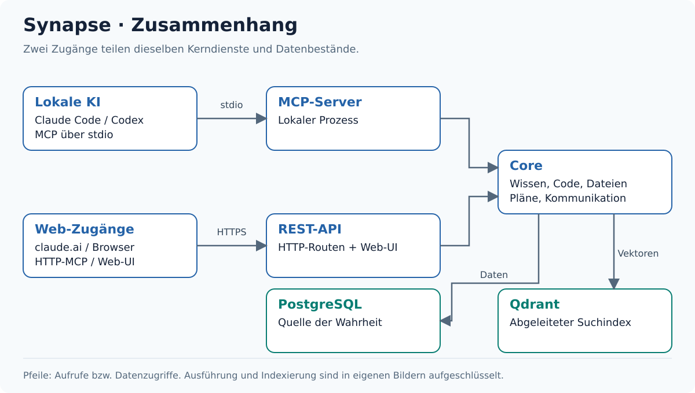
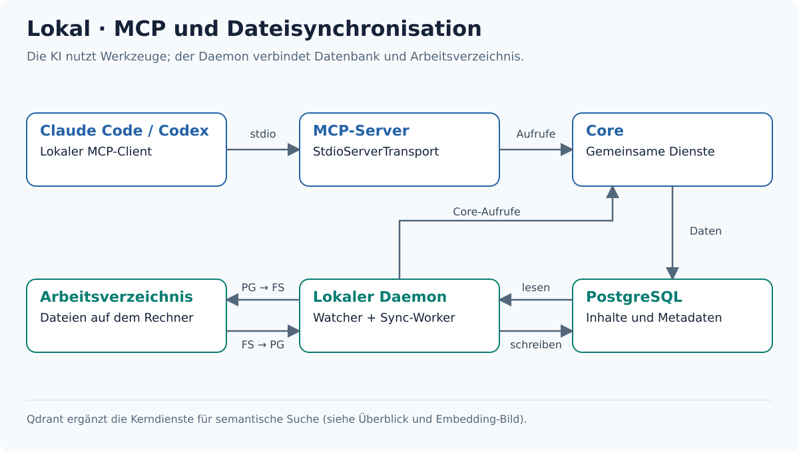
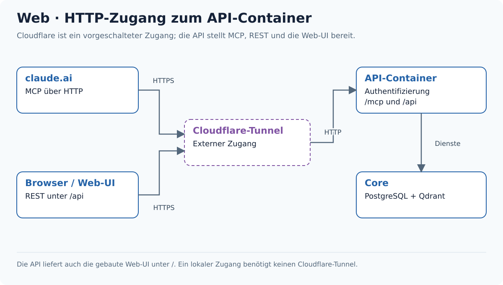
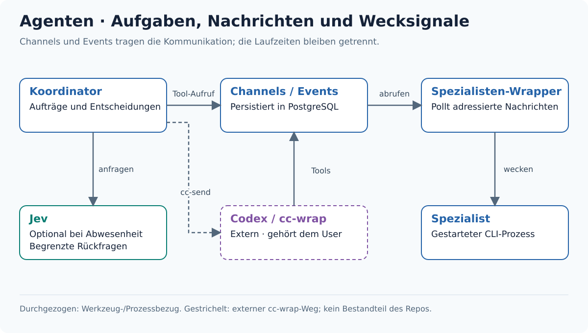
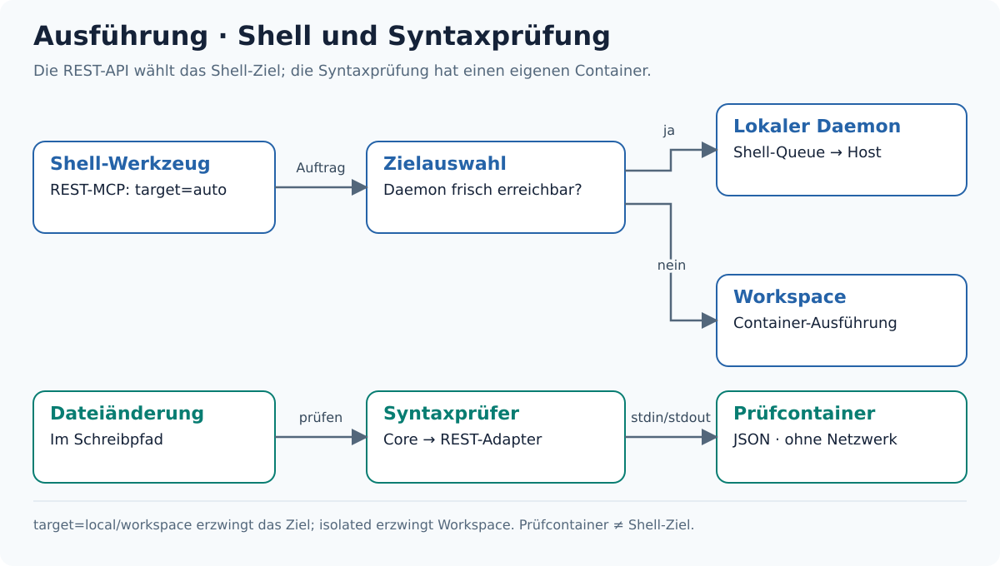
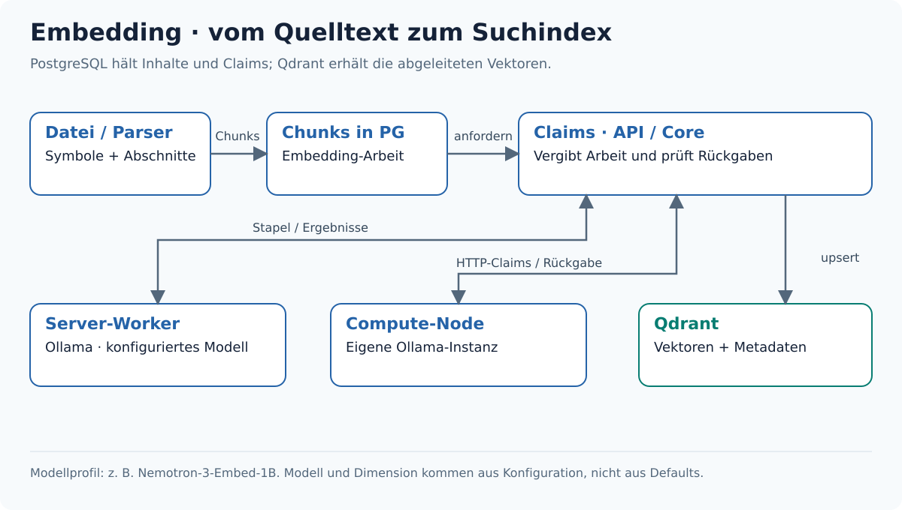

# Synapse

**Projektwissen, Code-Analyse und Werkzeuge für lokale und Web-KIs.**

Synapse verbindet Projektdateien mit dauerhaftem Wissen und gemeinsamer Agentenarbeit. PostgreSQL hält Inhalte, Aufgaben und Arbeitsstände; Qdrant ergänzt die semantische Suche.



[Zusammenhang und Quellen](docs/README.md) · [Werkzeuge](#werkzeuge) · [Schnellstart](#schnellstart) · [Projektstruktur](#projektstruktur) · [Konfiguration](#konfiguration)

## Was Synapse bereitstellt

- **Code verstehen:** [Code-Intelligence](packages/mcp-server/src/tools/consolidated/code-intel.ts) erschließt Dateien, Symbole, Referenzen und Abläufe. [Parser](packages/core/src/parser/README.md) und [Asset-Intelligence](packages/core/src/asset-intel/README.md) behandeln Quelltext und Binärformate mit unterschiedlichen Analyseverfahren.
- **Wissen behalten:** [Memories, Thoughts und Pläne](packages/core/src/services/README.md) speichern Erkenntnisse und Aufgaben dauerhaft. Benannte Wissensabrufe kommen aus PostgreSQL, semantische Suchen nutzen den Vektorindex.
- **Änderungen nachvollziehen:** [Dateiwerkzeuge](packages/mcp-server/src/tools/consolidated/files.ts) verbinden Versionierung, Änderungspläne und Co-Edit. Syntaxprüfungen unterstützen den Schreibpfad.
- **Zusammenarbeiten:** [Agenten](packages/agents/README.md), Channels und Events verbinden Koordinator und Spezialisten. [Shell und Workspaces](docs/README.md#variante-shell-ausführung-und-syntaxprüfung) binden die Ausführungsumgebung an.

## Wie funktioniert Synapse?

### Lokal: Claude Code oder Codex



Ein lokaler MCP-Client spricht den [MCP-Server](packages/mcp-server/README.md) über stdio an; dieser verwendet die gemeinsamen Core-Dienste. Der [TypeScript-Daemon](packages/file-watcher-daemon-ts/README.md) verbindet PostgreSQL und Arbeitsverzeichnis und führt lokale Aufträge aus. Der [Go-Tray](packages/file-watcher-daemon/tray/README.md) ergänzt die lokale Bedienung.

### Web: claude.ai und Web-UI



claude.ai verwendet HTTP-MCP, die [Web-UI](packages/web-ui/README.md) die REST-Schnittstellen. Die [API](packages/rest-api/README.md) übernimmt Authentifizierung, Werkzeugaufrufe und die Auslieferung der gebauten Oberfläche; ein vorgeschalteter Cloudflare-Tunnel ermöglicht den externen Zugang. Lokaler HTTP-Zugang ist auch ohne Tunnel möglich; einzelne UI-Bereiche enthalten noch [Beispieldaten](packages/web-ui/src/mock/README.md).

### Agententeams



Der [Spezialisten-Wrapper](packages/agents/README.md) liest adressierte Channel-Nachrichten und weckt den verwalteten CLI-Prozess; Channels und Events speichern die Kommunikation. Codex kann über den externen, vom User verwalteten `cc-wrap` arbeiten, mit `cc-send` als kurzem Wecksignal. Jev kann bei aktivierter Abwesenheitsregel begrenzte Rückfragen entscheiden.

### Ausführung und Prüfung



REST-Shell-Aufträge gehen automatisch an einen erreichbaren lokalen Daemon oder andernfalls an einen [Workspace](docker/synapse-workspace/README.md); das Ziel lässt sich ausdrücklich wählen. Der [Prüfcontainer](docker/synapse-pruefcontainer/README.md) ist separat und prüft Syntax ohne Netzwerkzugang. [Podman-Workspaces](docker/synapse-workspace-podman/README.md) ergänzen Container-Werkzeuge innerhalb der Sandbox.

### Wissen und Embedding



Die Code-Pipeline erzeugt Symbole und Chunks; Server-Worker oder [Compute-Nodes](packages/compute-node-agent/README.md) bearbeiten Embedding-Claims mit Ollama. Die API prüft zurückgelieferte Vektoren vor der Übernahme in Qdrant. [Modellprofile](packages/core/src/embeddings/README.md) bestimmen Modell und Dimension; das dokumentierte Nemotron-3-Embed-1B-Profil verwendet 1024 Dimensionen, keinen festverdrahteten Modell-Fallback.

Die [Zusammenhangsdokumentation](docs/README.md) erklärt die Schnittstellen genauer. Die [Bildübersicht](docs/bilder/README.md) verknüpft jede Ansicht mit ihren Codequellen; [Konzepte](docs/konzepte/README.md) sind separat ausgewiesen.

### Funktionsweise im Detail

[Tray](packages/file-watcher-daemon/tray/README.md#funktionsweise) · [Daemon](packages/file-watcher-daemon-ts/src/README.md#funktionsweise) · [Dateiänderungen](packages/core/src/services/README.md#dateiänderungen-co-edit-und-platten-synchronisation) · [Shell](packages/core/src/services/README.md#shell-ausführung-und-workspaces) · [Workspaces](packages/rest-api/src/services/README.md#funktionsweise-workspaces)

[Kommunikation](packages/core/src/services/README.md#kommunikation-und-hinweiszustellung) · [Wrapper](packages/agents/src/README.md#funktionsweise) · [Jev](packages/core/src/services/README.md#jev-und-entscheidungen) · [Syntaxprüfung](packages/core/src/services/README.md#syntaxprüfung-und-erklärungsfälle)

[Embedding](packages/core/src/embeddings/README.md#funktionsweise) · [Assets](packages/core/src/asset-intel/README.md#funktionsweise) · [Auth und Projekte](docs/README.md#authentifizierung-und-projekte) · [Web-UI und Wissen](docs/README.md#web-oberfläche-und-wissen)

## Werkzeuge

Die Tabelle dient zur Orientierung. Die genaue Aktionsreferenz liefert [guide](packages/core/src/guide/README.md); maßgeblich für Verfügbarkeit und Parameter sind das [stdio-Register](packages/mcp-server/src/server.ts) und das [REST-MCP-Register](packages/rest-api/src/routes/mcp.ts). Einzelne Aktionen und kontextabhängige Werkzeuge können sich unterscheiden.

| Werkzeug | Aufgabe | Zugang |
| --- | --- | --- |
| [project](packages/mcp-server/src/tools/consolidated/project.ts) | Projektstatus, Einrichtung und projektbezogene Verwaltung | stdio / REST-MCP |
| [code_intel](packages/mcp-server/src/tools/consolidated/code-intel.ts) | Dateien, Symbole, Referenzen, Abläufe sowie lexikalische und semantische Codesuche | stdio / REST-MCP |
| [asset_intel](packages/mcp-server/src/tools/consolidated/asset-intel.ts) | Struktur und Referenzen von Binärdateien, Medien und Projekt-Assets | stdio / REST-MCP |
| [search](packages/mcp-server/src/tools/consolidated/search.ts) | Suche über projektbezogene Wissensbereiche | stdio / REST-MCP |
| [files](packages/mcp-server/src/tools/consolidated/files.ts) | Versionierte Dateiänderungen, Änderungspläne und gemeinsames Bearbeiten | stdio / REST-MCP |
| [shell](packages/mcp-server/src/tools/consolidated/shell.ts) | Ausführungsaufträge, Status, Logs und Aktivität | stdio / REST-MCP |
| [code_check](packages/mcp-server/src/tools/consolidated/code-check.ts) | Syntaxprüfung, bekannte Fehlermuster und Erklärungsfälle | stdio / REST-MCP |
| [ignore](packages/mcp-server/src/tools/consolidated/ignore.ts) | Projektbezogene Ausschlussregeln | stdio / REST-MCP |
| [memory](packages/mcp-server/src/tools/consolidated/memory.ts) | Benanntes Projektwissen und semantische Wissenssuche | stdio / REST-MCP |
| [thought](packages/mcp-server/src/tools/consolidated/thought.ts) | Arbeitsnotizen und Berichte | stdio / REST-MCP |
| [proposal](packages/mcp-server/src/tools/consolidated/proposal.ts) | Änderungsvorschläge | stdio / REST-MCP |
| [plan](packages/mcp-server/src/tools/consolidated/plan.ts) | Pläne und Aufgaben | stdio / REST-MCP |
| [chat](packages/mcp-server/src/tools/consolidated/chat.ts) | Agentenregistrierung und direkte Nachrichten | stdio / REST-MCP |
| [channel](packages/mcp-server/src/tools/consolidated/channel.ts) | Gruppenkommunikation und Mitgliedschaft | stdio / REST-MCP |
| [event](packages/mcp-server/src/tools/consolidated/event.ts) | Steuersignale und Bestätigungen | stdio / REST-MCP |
| [specialist](packages/mcp-server/src/tools/consolidated/specialist.ts) | Persistente Spezialisten und deren Lebenszyklus | stdio / REST-MCP |
| [jev](packages/mcp-server/src/tools/consolidated/jev.ts) | Begrenzte Entscheidungen bei Abwesenheit und Entscheidungsprotokoll | stdio / REST-MCP |
| [docs](packages/mcp-server/src/tools/consolidated/docs.ts) | Technische Dokumentation und dateibezogene Hinweise | stdio / REST-MCP |
| [admin](packages/mcp-server/src/tools/consolidated/admin.ts) | Statistiken und Wartungsfunktionen | stdio / REST-MCP |
| [free_models](packages/mcp-server/src/tools/consolidated/free-models.ts) | Modellpool und Modellabfragen | stdio |
| [guide](packages/mcp-server/src/tools/consolidated/guide.ts) | Werkzeugübersicht und Aktionsreferenz | stdio / REST-MCP |
| [files_batch](packages/rest-api/src/routes/mcp.ts) | Separater Zugang zu Datei-Batch- und Co-Edit-Aktionen | REST-MCP |
| [skills](skills/README.md) | Skill-Inhalte und Abschnitte lesen, suchen und pflegen | REST-MCP |
| [workspace](packages/rest-api/src/services/README.md) | Sandboxen, benannte Instanzen und Ressourcen | REST-MCP |
| [artefakt](packages/web-ui/src/kios/README.md) | HTML-Artefakte in den Web-UI-Antwortstrom liefern | REST-MCP, Hauptagent |
| [intern](packages/rest-api/src/routes/mcp.ts) | Interne Diagnose und Worker-Steuerung | REST-MCP, explizit aktiviert |

Die Parser liefern formatabhängige statische Analysen; ein Index ersetzt weder Compiler noch Laufzeittest. Die [Testübersichten](packages/core/tests/README.md) dokumentieren die vorhandenen Prüfsuiten.

## Schnellstart

Vorausgesetzt sind mise, pnpm sowie erreichbare PostgreSQL-, Qdrant- und konfigurierte Embedding-Dienste. [.mise.toml](.mise.toml) legt Node 20 und die Projektaufgaben fest.

```bash
cd ~/dev/synapse
mise install
pnpm install --frozen-lockfile
mise run build
```

Die Verbindungseinstellungen kommen aus der Umgebung beziehungsweise einer lokalen `.env`; Beispiele für den MCP-Client stehen in [.mcp.json.example](.mcp.json.example). Datenbank- und Embedding-Konfiguration sind vor dem Start erforderlich. `mise run dev` startet den lokalen MCP-Entwicklungsserver, `mise run dev:api` die REST-API.

Für Container gibt es [Dockerfile](Dockerfile) und [Compose](docker-compose.yml); dessen optionales `bundled`-Profil ergänzt PostgreSQL und Qdrant. Das [Laufzeitschema](packages/core/src/db/schema.ts) ist vom [SQL-Kaltstartspiegel](packages/core/src/db/schema-sql/README.md) zu unterscheiden; Schema-Modus und Startverhalten sind im [Datenbankbereich](packages/core/src/db/README.md) eingeordnet.

## Konfiguration

| Datei | Rolle |
| --- | --- |
| [package.json](package.json) | Workspace-Pakete, Build-/Dev-/Lint-/Clean-Skripte und Node-Anforderung |
| [pnpm-workspace.yaml](pnpm-workspace.yaml) | Paketmenge des pnpm-Workspaces |
| [.mise.toml](.mise.toml) | Node-Version und Projektaufgaben |
| [docker-compose.yml](docker-compose.yml) | API-Dienst, optionales `bundled`-Profil, Daten- und Schema-Volumes |
| [Dockerfile](Dockerfile) | Baut Core, API und Web-UI zum REST-API-Image |
| [.mcp.json.example](.mcp.json.example) | Beispielstruktur für lokale MCP-Anbindung und Umgebungsvariablen |
| [shell-setup.example.fish](shell-setup.example.fish) | Fish-Alias für den Claude-Sitzungswrapper und lokale Konfigurationsquellen |
| [tsconfig.base.json](tsconfig.base.json) | Gemeinsame TypeScript-Compileroptionen |

Die [Core-Konfiguration](packages/core/src/config.ts) und die [Embedding-Module](packages/core/src/embeddings/README.md) beschreiben Datenbank-, Such- und Provider-Anbindungen. Modellwerte stammen aus dem konfigurierten Profil. API-/Daemon- und Container-Einstellungen stehen in den jeweiligen Ordner-READMEs.

## Projektstruktur

Jeder Link führt zur README des betreffenden Ordners. Die aufklappbaren Bäume enthalten auch interne Module und Testdaten; Einstiegspunkte sind [Pakete](packages/README.md), [Container](docker/README.md) und [Dokumentation](docs/README.md).

<details>
<summary>Dokumentation und Container</summary>

- [docker/](docker/README.md)
  - [synapse-pruefcontainer/](docker/synapse-pruefcontainer/README.md)
    - [jvm/](docker/synapse-pruefcontainer/jvm/README.md)
    - [pruefgo/](docker/synapse-pruefcontainer/pruefgo/README.md)
    - [ts_sprachen/](docker/synapse-pruefcontainer/ts_sprachen/README.md)
  - [synapse-workspace-podman/](docker/synapse-workspace-podman/README.md)
  - [synapse-workspace/](docker/synapse-workspace/README.md)
- [docs/](docs/README.md)
  - [bilder/](docs/bilder/README.md)
  - [konzepte/](docs/konzepte/README.md)

</details>

<details>
<summary>Core</summary>

- [core/](packages/core/README.md)
  - [data/](packages/core/data/README.md)
  - [scripts/](packages/core/scripts/README.md)
  - [src/](packages/core/src/README.md)
    - [asset-intel/](packages/core/src/asset-intel/README.md)
      - [inspectors/](packages/core/src/asset-intel/inspectors/README.md)
        - [3d/](packages/core/src/asset-intel/inspectors/3d/README.md)
        - [archiv/](packages/core/src/asset-intel/inspectors/archiv/README.md)
        - [dcc/](packages/core/src/asset-intel/inspectors/dcc/README.md)
        - [exe/](packages/core/src/asset-intel/inspectors/exe/README.md)
        - [medien/](packages/core/src/asset-intel/inspectors/medien/README.md)
        - [textur/](packages/core/src/asset-intel/inspectors/textur/README.md)
        - [unreal/](packages/core/src/asset-intel/inspectors/unreal/README.md)
    - [chunking/](packages/core/src/chunking/README.md)
    - [db/](packages/core/src/db/README.md)
      - [schema-sql/](packages/core/src/db/schema-sql/README.md)
    - [embeddings/](packages/core/src/embeddings/README.md)
    - [guide/](packages/core/src/guide/README.md)
    - [migrations/](packages/core/src/migrations/README.md)
    - [parser/](packages/core/src/parser/README.md)
      - [__testdata__/](packages/core/src/parser/__testdata__/README.md)
      - [patterns/](packages/core/src/parser/patterns/README.md)
    - [qdrant/](packages/core/src/qdrant/README.md)
    - [services/](packages/core/src/services/README.md)
      - [syntax-pruefer/](packages/core/src/services/syntax-pruefer/README.md)
    - [types/](packages/core/src/types/README.md)
    - [watcher/](packages/core/src/watcher/README.md)
  - [tests/](packages/core/tests/README.md)
    - [_helfer/](packages/core/tests/_helfer/README.md)
    - [fixtures/](packages/core/tests/fixtures/README.md)

</details>

<details>
<summary>Weitere Pakete</summary>

- [packages/](packages/README.md)
  - [agents-antigravity/](packages/agents-antigravity/README.md)
    - [src/](packages/agents-antigravity/src/README.md)
  - [agents-gemini/](packages/agents-gemini/README.md)
    - [src/](packages/agents-gemini/src/README.md)
      - [public/](packages/agents-gemini/src/public/README.md)
  - [agents/](packages/agents/README.md)
    - [src/](packages/agents/src/README.md)
      - [transport/](packages/agents/src/transport/README.md)
      - [wissen/](packages/agents/src/wissen/README.md)
  - [compute-node-agent/](packages/compute-node-agent/README.md)
    - [src/](packages/compute-node-agent/src/README.md)
  - [file-watcher-daemon-ts/](packages/file-watcher-daemon-ts/README.md)
    - [src/](packages/file-watcher-daemon-ts/src/README.md)
  - [file-watcher-daemon/](packages/file-watcher-daemon/README.md)
    - [src/](packages/file-watcher-daemon/src/README.md)
    - [tests/](packages/file-watcher-daemon/tests/README.md)
    - [tray/](packages/file-watcher-daemon/tray/README.md)
  - [mcp-server/](packages/mcp-server/README.md)
    - [hooks/](packages/mcp-server/hooks/README.md)
    - [src/](packages/mcp-server/src/README.md)
      - [tools/](packages/mcp-server/src/tools/README.md)
        - [consolidated/](packages/mcp-server/src/tools/consolidated/README.md)
          - [utils/](packages/mcp-server/src/tools/consolidated/utils/README.md)
    - [tests/](packages/mcp-server/tests/README.md)
  - [rest-api/](packages/rest-api/README.md)
    - [src/](packages/rest-api/src/README.md)
      - [middleware/](packages/rest-api/src/middleware/README.md)
      - [routes/](packages/rest-api/src/routes/README.md)
      - [services/](packages/rest-api/src/services/README.md)
        - [agent-runtime/](packages/rest-api/src/services/agent-runtime/README.md)
    - [tests/](packages/rest-api/tests/README.md)
  - [web-ui/](packages/web-ui/README.md)
    - [src/](packages/web-ui/src/README.md)
      - [api/](packages/web-ui/src/api/README.md)
      - [components/](packages/web-ui/src/components/README.md)
        - [control-plane/](packages/web-ui/src/components/control-plane/README.md)
      - [control-plane/](packages/web-ui/src/control-plane/README.md)
      - [graph/](packages/web-ui/src/graph/README.md)
      - [kios/](packages/web-ui/src/kios/README.md)
      - [mock/](packages/web-ui/src/mock/README.md)

</details>

<details>
<summary>Skripte, Skills und Testdaten</summary>

- [coedit-test/](coedit-test/README.md)
- [parser-fixtures/](parser-fixtures/README.md)
  - [cpp-deep/](parser-fixtures/cpp-deep/README.md)
    - [include/](parser-fixtures/cpp-deep/include/README.md)
      - [cpp_fixture/](parser-fixtures/cpp-deep/include/cpp_fixture/README.md)
    - [src/](parser-fixtures/cpp-deep/src/README.md)
- [scripts/](scripts/README.md)
  - [context-handoff/](scripts/context-handoff/README.md)
  - [erklaerungen/](scripts/erklaerungen/README.md)
  - [lib/](scripts/lib/README.md)
- [skills/](skills/README.md)
  - [projekt-architektur/](skills/projekt-architektur/README.md)
  - [projekt-regeln/](skills/projekt-regeln/README.md)
  - [projekt-setup/](skills/projekt-setup/README.md)
  - [projekt-status/](skills/projekt-status/README.md)
  - [synapse-agent-regeln/](skills/synapse-agent-regeln/README.md)
  - [synapse-nutzung/](skills/synapse-nutzung/README.md)
    - [scripts/](skills/synapse-nutzung/scripts/README.md)
- [test-fixtures/](test-fixtures/README.md)
  - [parser/](test-fixtures/parser/README.md)
    - [cpp/](test-fixtures/parser/cpp/README.md)

</details>

## Entwicklung und Tests

Builds und Entwicklung verwenden die Aufgaben aus [.mise.toml](.mise.toml). Tests sind in [Core](packages/core/tests/README.md), [REST-API](packages/rest-api/tests/README.md), [MCP-Server](packages/mcp-server/tests/README.md), [Daemon](packages/file-watcher-daemon/tests/README.md) und [Skripten](scripts/README.md) beschrieben.

Datenbanktests verwenden ausschließlich `synapse_test` auf Port 5433 mit eigenen Testdaten. Projektbezogene Agentenregeln stehen in [AGENTS.md](AGENTS.md); ergänzende Anleitungen und Arbeitsregeln sind unter [Skills](skills/README.md) eingeordnet.
