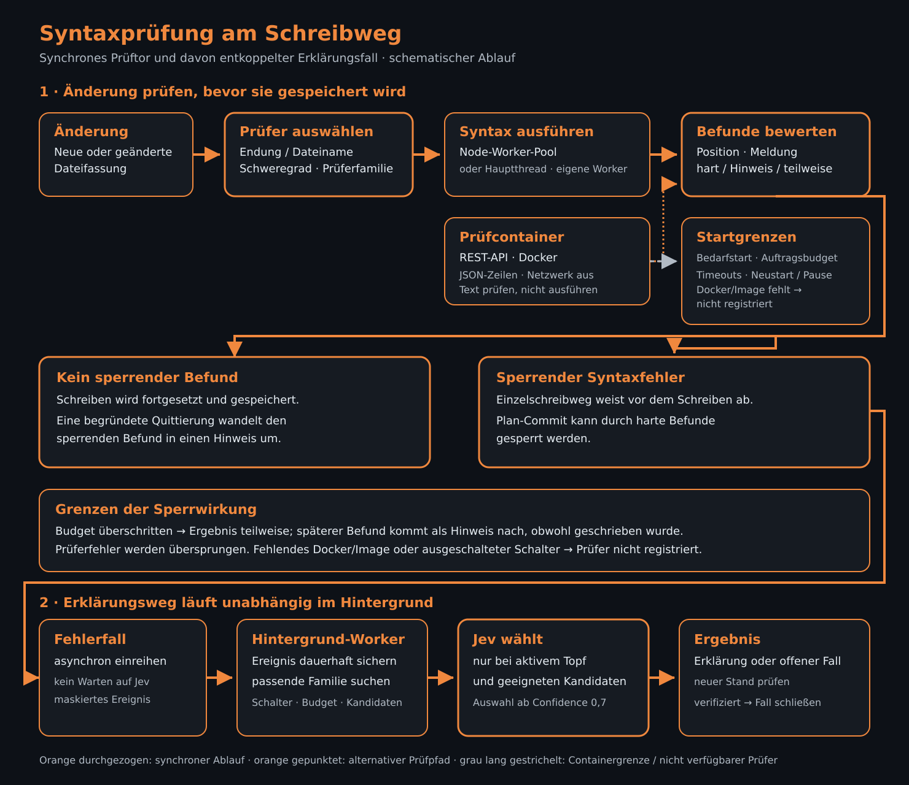
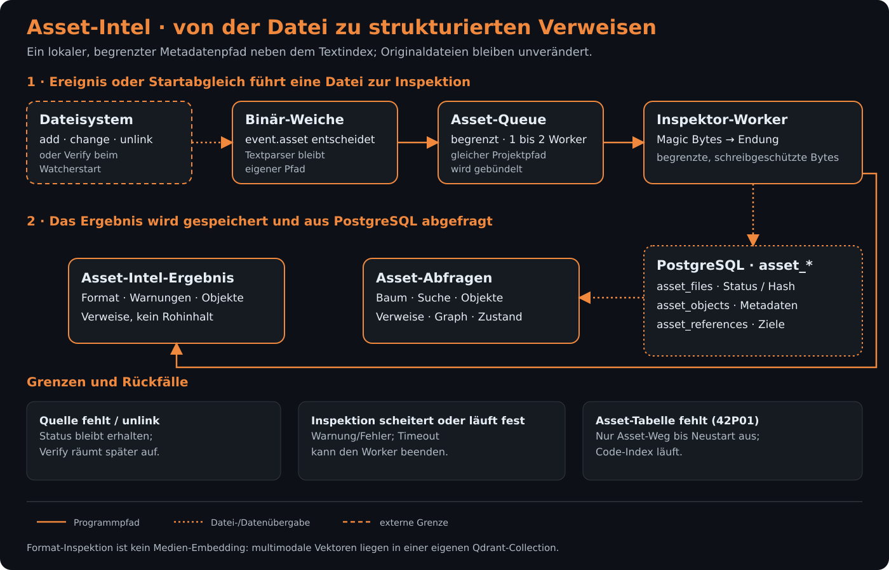
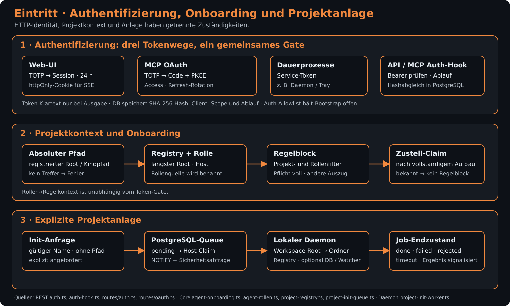
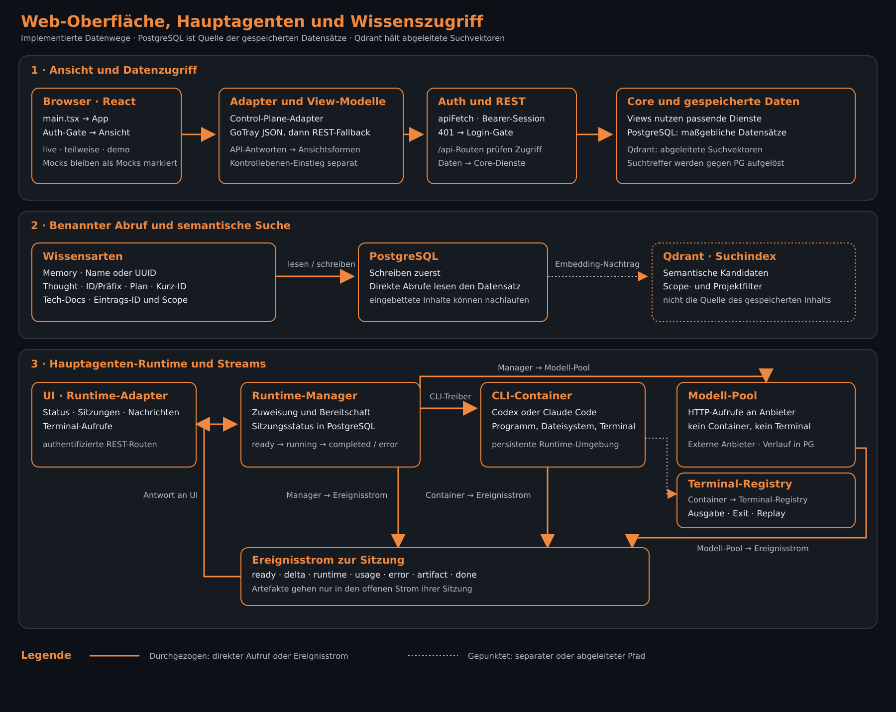

# Architekturbilder

[Synapse](../../README.md) › [Dokumentation](../README.md) › Bilder

## Zweck

Die eigenständigen SVGs visualisieren den Zusammenhang der implementierten Komponenten. Die [Zusammenhangsseite](../README.md) erläutert die Varianten und verlinkt ihre Ordnerdokumentation.

## Inhalt

| Datei | Aufgabe |
| --- | --- |
| [ueberblick.svg](ueberblick.svg) | Zugänge, Core und Datenhaltung |
| [lokal.svg](lokal.svg) | stdio-MCP und Dateisynchronisation |
| [web.svg](web.svg) | HTTP-MCP, Web-UI und vorgeschalteter Tunnel |
| [agenten.svg](agenten.svg) | Channels, Events und externe Anbindungen |
| [ausfuehrung.svg](ausfuehrung.svg) | Shell-Zielwahl und separater Prüfcontainer |
| [tray.svg](tray.svg) | Go- und Moo-Oberfläche, Status und Rückfälle |
| [daemon.svg](daemon.svg) | Registry, Dateisynchronisation und lokale Jobs |
| [files.svg](files.svg) | Entwurf, Co-Edit, Commit und Plattenbestätigung |
| [shell.svg](shell.svg) | Startprüfung, Ausführung und Ergebnis |
| [workspace.svg](workspace.svg) | Containerzustände und Materialisierung |
| [kommunikation.svg](kommunikation.svg) | Channels, Chat, Inbox, Events und Zustandsmarken |
| [wrapper.svg](wrapper.svg) | Prozessgrenzen, Heartbeat und Kontextwechsel |
| [jev.svg](jev.svg) | Entscheidung, Budget und Durchsicht |
| [pruefung.svg](pruefung.svg) | Synchrones Schreibtor und asynchroner Erklärungsweg |
| [embedding.svg](embedding.svg) | Parser, Chunks, Claims, Ollama und Qdrant |
| [asset.svg](asset.svg) | Binärdatei, begrenzte Inspektion und Asset-Index |
| [auth.svg](auth.svg) | Token, Onboarding und Projektanlage |
| [ui.svg](ui.svg) | Ansichten, Runtime-Sitzungen und Wissenszugriff |

### Gesamtbild

### Lokale KI

### Web-Zugang

### Agententeam

### Ausführung

### Tray

### Daemon

### Dateiänderungen

### Shell

### Workspaces

### Kommunikation

### Spezialisten-Wrapper

### Jev

### Syntaxprüfung

### Embedding

### Asset-Intelligence

### Authentifizierung und Projekte

### Web-Oberfläche, Hauptagenten und Wissen

## Quellen der Verbindungen

Die folgenden Codepfade belegen die Kanten. Die verlinkten Funktionsweise-Abschnitte erläutern Zustände und Grenzen; Dateilinks bleiben auch bei späteren Zeilenverschiebungen verwendbar.

| Bild | Belege |
| --- | --- |
| Gesamtbild | [MCP-Server](../../packages/mcp-server/src/server.ts), [HTTP-MCP](../../packages/rest-api/src/routes/mcp.ts), [PG-Client](../../packages/core/src/db/client.ts), [Qdrant-Client](../../packages/core/src/qdrant/client.ts) |
| Lokal | [stdio-Transport](../../packages/mcp-server/src/server.ts), [Daemon-Worker und Sync](../../packages/file-watcher-daemon-ts/src/main.ts), [Watcher-Manager](../../packages/file-watcher-daemon-ts/src/manager.ts) |
| Web | [API-Server: Auth, Routen, statische Web-UI](../../packages/rest-api/src/server.ts), [Web-UI-Client](../../packages/web-ui/src/api/synapse-client.ts), [Container-Komposition](../../docker-compose.yml) |
| Agenten | [Channel-Polling im Wrapper](../../packages/agents/src/wrapper.ts), [CLI-Prozessstart](../../packages/agents/src/process.ts), [Channels](../../packages/core/src/services/channels.ts), [Events](../../packages/core/src/services/events.ts), [Jev](../../packages/core/src/services/jev-entscheidung.ts), [cc-send-Anbindung](../../scripts/codex-kontext-hook.mjs), [Abgrenzung cc-wrap](../../AGENTS.md) |
| Ausführung | [REST-Shell-Routing](../../packages/rest-api/src/routes/mcp.ts), [Daemon-Shell-Worker](../../packages/file-watcher-daemon-ts/src/main.ts), [Prüfcontainer-Adapter](../../packages/rest-api/src/services/pruef-container.ts) |
| Embedding | [Code-Pipeline](../../packages/core/src/services/code.ts), [Server-Worker](../../packages/rest-api/src/services/parser-worker.ts), [Compute-Node](../../packages/compute-node-agent/src/index.ts), [Claim-Abschluss und Qdrant](../../packages/core/src/services/embedding-claims.ts), [Modellprofil](../../scripts/p15-t8-modellprofile-startwerte.sql) |
| Web-Oberfläche, Hauptagenten und Wissen | [React-Einstieg und Auth-Gate](../../packages/web-ui/src/main.tsx), [Control-Plane-Adapter](../../packages/web-ui/src/api/control-plane-adapter.ts), [Runtime-Manager und Routen](../../packages/rest-api/src/services/agent-runtime/manager.ts), [Memory](../../packages/core/src/services/memory.ts), [Thoughts](../../packages/core/src/services/thoughts.ts), [Plans](../../packages/core/src/services/plans.ts), [Tech-Docs](../../packages/core/src/services/tech-docs.ts) |

### Detailbilder

| Bild | Funktionsweise und Quellverweise |
| --- | --- |
| [tray.svg](tray.svg), [daemon.svg](daemon.svg) | [Tray](../../packages/file-watcher-daemon/tray/README.md#funktionsweise) · [Daemon](../../packages/file-watcher-daemon-ts/src/README.md#funktionsweise) |
| [files.svg](files.svg) | [Schreibweg](../../packages/core/src/services/README.md#dateiänderungen-co-edit-und-platten-synchronisation) |
| [shell.svg](shell.svg), [workspace.svg](workspace.svg) | [Shell](../../packages/core/src/services/README.md#shell-ausführung-und-workspaces) · [Workspaces](../../packages/rest-api/src/services/README.md#funktionsweise-workspaces) |
| [kommunikation.svg](kommunikation.svg) | [Zustellung und Lesestand](../../packages/core/src/services/README.md#kommunikation-und-hinweiszustellung) |
| [wrapper.svg](wrapper.svg) | [Wrapper](../../packages/agents/src/README.md#funktionsweise) |
| [jev.svg](jev.svg) | [Entscheidungsweg](../../packages/core/src/services/README.md#jev-und-entscheidungen) |
| [pruefung.svg](pruefung.svg) | [Prüfung und Erklärungsfälle](../../packages/core/src/services/README.md#syntaxprüfung-und-erklärungsfälle) |
| [embedding.svg](embedding.svg), [asset.svg](asset.svg) | [Parser](../../packages/core/src/parser/README.md#funktionsweise) · [Embedding](../../packages/core/src/embeddings/README.md#funktionsweise) · [Assets](../../packages/core/src/asset-intel/README.md#funktionsweise) |
| [auth.svg](auth.svg) | [Authentifizierung](../../packages/rest-api/src/services/README.md#funktionsweise-authentifizierung) · [Onboarding und Anlage](../../packages/core/src/services/README.md#authentifizierung-onboarding-und-projektzuordnung) |

## Schnittstellen nach außen

Die SVGs werden als relative Markdown-Bilder eingebunden. Sie enthalten keine Skripte, externen Schriftdateien oder nachgeladenen Bildressourcen. Die GitHub-Primer-Dark-Palette verwendet einen festen Hintergrund (#0d1117), Kästen (#161b22), neutrale Trennlinien (#30363d), orangene Akzente (#f0883e), Fließtext (#e6edf3) und helleren Nebentext (#b1bac4). Das Bild bleibt damit in hellen und dunklen GitHub-Themes lesbar. Der Textkontrast beträgt mindestens 14,64:1 für Fließtext, 8,81:1 für Nebentext und 6,83:1 für Orange. Der hellere Nebentext ersetzt #848d97, das die Vorgabe von 7:1 unterschreitet. Alle Bilder besitzen Titel und Beschreibung; Hauptbeschriftungen und ergänzende Hinweise sind nach ihrer Bedeutung abgestuft.

Pfeile zeigen die jeweils beschrifteten Aufrufe oder Datenwege, keine vollständige zeitliche Ablaufspur. Die Legenden der Detailbilder erläutern die jeweiligen Linienarten. In den Übersichtsbildern gruppieren kurz gepunktete Konturen Datenspeicher sowie ergänzende oder optionale Komponenten. Lange Striche kennzeichnen dort externe Komponenten und Wege, insbesondere cc-wrap und den vorgeschalteten Cloudflare-Tunnel.

## Abhängigkeiten

SVG-fähige Markdown-/Browserdarstellung genügt. Die PNG-Vorschauen zur Sichtprüfung sind temporäre Renderartefakte und gehören nicht zum Repository.

## Siehe auch

- [Zusammenhang und Varianten](../README.md)
- [Paketverzeichnis](../../packages/README.md)
- [Architekturkonzepte](../konzepte/README.md)
