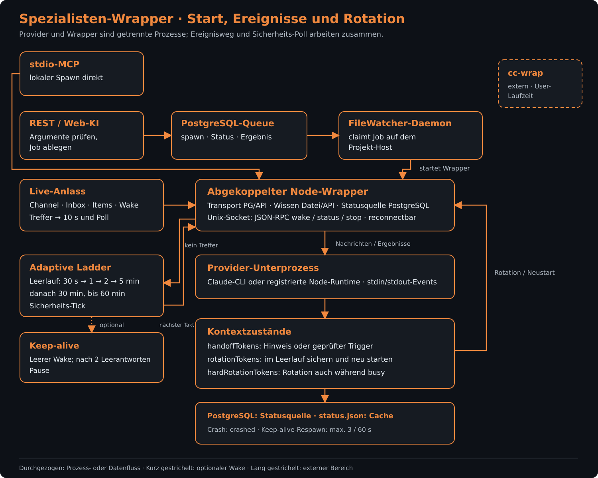

# Agenten-Quellcode

[Synapse](../../../README.md) › [Übergeordneter Ordner](../README.md) › Agenten-Quellcode

## Zweck

Dieser Ordner enthält die gemeinsame Implementierung persistenter Spezialisten-Wrapper. Er trennt KI-Prozess, Kommunikation, Zustandsentscheidungen sowie Wissen und Status in eigene Module.

## Inhalt

### Exports und Laufzeit

| Datei / Unterordner | Aufgabe |
|---|---|
| [`index.ts`](index.ts) | Bündelt die öffentlichen Paket-Exports. |
| [`types.ts`](types.ts) | `SpecialistConfig`, `SpecialistStatus` und `StatusFile` beschreiben Konfiguration und Statusformen. |
| [`models.ts`](models.ts) | `resolveModel` und `loadFromDb` verbinden die Modell-Registry mit dem statischen Bootstrap-Rückfall. |
| [`detect.ts`](detect.ts) | `detectClaudeCli` ermittelt Informationen zur verfügbaren Claude-CLI. |
| [`runtime-pfad.ts`](runtime-pfad.ts) | `loeseRuntimePfad` löst die Laufzeitdatei einer Provider-Runtime auf. |
| [`process.ts`](process.ts) | `ProcessManager` kapselt den KI-Subprozess und dessen Nachrichten-/Ereignisschnittstelle. |
| [`wrapper.ts`](wrapper.ts) | Verbindet KI-Prozess, Socket-Steuerung, Heartbeat und Wissenszugriff im Wrapper-Prozess. |

### Kommunikation und Zustandssteuerung

| Datei / Unterordner | Aufgabe |
|---|---|
| [`channels.ts`](channels.ts) | Re-exportiert Core-Funktionen wie `createChannel`, `joinChannel` und `postMessage`. |
| [`inbox.ts`](inbox.ts) | Re-exportiert Core-Funktionen wie `postToInbox`, `checkInbox` und `getInboxHistory`. |
| [`channel-push.ts`](channel-push.ts) | `baueChannelPush` erzeugt adressierte Volltexte und begrenzte Vorschauen für Channel-Nachrichten. |
| [`heartbeat.ts`](heartbeat.ts) | `HeartbeatController` verwaltet Unix-Sockets und JSON-RPC-Kommandos zu Wrappern. |
| [`heartbeat-state.ts`](heartbeat-state.ts) | `createState`, `onEvent` und `nextDelayMs` bilden die adaptive Heartbeat-Zustandsmaschine. |
| [`heartbeat-entscheidung.ts`](heartbeat-entscheidung.ts) | `entscheideAbgeschaltet` bestimmt die Wrapper-Reaktion bei abgeschaltetem Heartbeat. |
| [`leerlauf-entscheidung.ts`](leerlauf-entscheidung.ts) | `nachLeerlaufWake` und `beiEchtemAnlass` steuern die Leerlauf-Pause von Keep-alive-Weckrufen. |
| [`rotations-marker.ts`](rotations-marker.ts) | `rotationsMarkerAktion` bestimmt die Wirksamkeit eines angeforderten Rotations-Markers. |
| [`token-stand.ts`](token-stand.ts) | `berechneTokenStand` leitet den Kontextstand aus Claude-Session-JSONL-Ereignissen ab. |

### Wissen und Status

| Datei / Unterordner | Aufgabe |
|---|---|
| [`prompts.ts`](prompts.ts) | `buildSpecialistPrompt` erstellt den Systemprompt aus Konfiguration und Wissen. |
| [`werkzeuge-laden.ts`](werkzeuge-laden.ts) | `baueWerkzeugHinweis` erstellt den Hinweis zum gezielten Laden benötigter Werkzeuge. |
| [`skills.ts`](skills.ts) | `readMeta`, `readSkillFile` und `writeSkillFile` verwalten lokale Metadaten und Wissensdateien. |
| [`status.ts`](status.ts) | `readStatus`, `writeStatus` und `updateSpecialist` pflegen den lokalen Statuscache neben dem primären PG-Status. |
| [`schema.ts`](schema.ts) | `AGENTS_SCHEMA` und `ensureAgentsSchema` definieren und initialisieren Agenten-Datenbankobjekte. |

### Zugriffsschichten

| Datei / Unterordner | Aufgabe |
|---|---|
| [`transport/`](transport/README.md) | Enthält den austauschbaren Zugriff über PostgreSQL oder HTTP. |
| [`wissen/`](wissen/README.md) | Enthält Dateisystem- und API-Adapter für Agentenwissen. |

## Schnittstellen nach außen

[index.ts](index.ts) bündelt die Paket-Exports. [HeartbeatController](heartbeat.ts) verwendet JSON-RPC über Unix-Sockets; [wrapper.ts](wrapper.ts) ist das Gegenstück im Spezialistenprozess. [types.ts](types.ts) beschreibt Konfiguration und Statusformen.

## Abhängigkeiten

Die Implementierung verwendet Node-Prozess-, Socket- und Dateisystem-Schnittstellen sowie [Core](../../core/README.md). Die [Transportadapter](transport/README.md) trennen Datenzugriffe, die [Wissensadapter](wissen/README.md) die Quelle des Agentenwissens.

## Funktionsweise

### Einstieg und Prozessgrenze

Ein Spawn über den lokalen stdio-MCP-Pfad läuft im MCP-Prozess: Er löst das Modell auf, prüft Runtime-Voraussetzungen und das Spezialistenlimit, liest beziehungsweise legt das Wissen an, baut den Prompt und startet den Wrapper. Beim REST/Web-Pfad liegt die CLI nicht im API-Container. Die API prüft die Spawn-Argumente, legt einen Job in der Specialist-Queue in PostgreSQL ab und wartet auf dessen Ergebnis; der FileWatcher-Daemon auf dem Projekt-Host übernimmt den Job und startet dort den Wrapper. Status- und Capability-Abfragen lesen dagegen direkt aus PostgreSQL. Belegt in [MCP-Specialist-Spawn](../../mcp-server/src/tools/specialists.ts), [REST-MCP-Route](../../rest-api/src/routes/mcp.ts), [Specialist-Queue](../../core/src/services/specialist-queue.ts) und [Daemon-Worker](../../file-watcher-daemon-ts/src/specialist-job-worker.ts).

Der Wrapper ist ein abgekoppelter Node-Prozess. Er startet darin einen Provider-Prozess: für Claude-Modelle die Claude-CLI, für andere registrierte Laufzeiten einen Node-Prozess. Zwischen Wrapper und Provider laufen Nachrichten über stdin/stdout; der Wrapper liest Stream-Ereignisse und hält damit Busy-Status, Aktivität und Tokenstand nach. Ein lokaler Unix-Domain-Socket stellt dem MCP-Prozess Wake-, Status- und Stop-Kommandos als zeilenbasiertes JSON-RPC bereit. Der Socket kann getrennt werden: der Heartbeat-Controller verwirft eine tote Verbindung und baut sie erneut auf. Beim Start prüft der Wrapper seine Pflichtkonfiguration, lädt Modellwerte und Prompt, startet den Provider sowie den Socket-Server und setzt die Nachrichten-Wasserstände. Der erste Heartbeat und der initiale Wake beginnen nach einer kurzen Startverzögerung, damit die Agenten-Werkzeuge verfügbar sind. Quellen: [Wrapper](wrapper.ts), [ProcessManager](process.ts), [Socket-Controller](heartbeat.ts).

### Ereignisse und Heartbeat

Ein Live-Ereignis wie ein adressierter Channel-Push, Inbox-Eintrag, Synapse-Item oder direkter Wake beschleunigt den nächsten Takt und setzt die adaptive Ladder auf 10 Sekunden zurück. Ein bloßes PG-NOTIFY ohne relevante Nachricht ist ein warmer Hinweis: es verkürzt einen langen Leerlauf höchstens auf den 30-Sekunden-Standard. Ohne neue Aktivität steigt der Abstand stufenweise von 30 Sekunden auf 1, 2, 5 und 30 Minuten bis zum Sicherheits-Tick nach 60 Minuten. Ein stabiler Namens-Offset verteilt gleichartige Takte verschiedener Wrapper. Ein konfigurierter fester Takt ersetzt die Ladder. Der Live-Kanal liefert schnelle Wecksignale; die Polls holen den Stand nach und bleiben der Rückfallweg, wenn ein Live-Kanal ausfällt. Quellen: [Heartbeat-Zustand](heartbeat-state.ts) und [Poll-/Live-Ablauf](wrapper.ts).

Keep-alive ist ein zusätzlicher leerer Wake, wenn der Poll keine neuen Nachrichten findet und der Agent nicht arbeitet; er ist selbst kein neues fachliches Ereignis. Nach zwei aufeinanderfolgenden leeren Antworten pausiert die Leerlauflogik solche Leer-Wakes. Ein späterer echter Anlass beendet die Pause; währenddessen gesammelte Dateiänderungen werden als gebündelter Hinweis an diesen Anlass angehängt. Wird der Heartbeat abgeschaltet, pollt der Wrapper nicht mehr selbstständig, bleibt aber über Wake und Live-Kanal erreichbar. Eine nachgewiesene Lücke im Live-Kanal oder ein wartender Wake erlaubt genau einen Nachhol-Poll, ohne den Heartbeat wieder einzuschalten. Quellen: [Leerlaufentscheidung](leerlauf-entscheidung.ts), [Abschaltentscheidung](heartbeat-entscheidung.ts) und [Heartbeat-Ablauf](wrapper.ts).

### Status, Transport und Wissen

PostgreSQL, Tabelle wrapper_status, ist die maßgebliche Statusquelle für laufende Wrapper. Der Wrapper schreibt Status und Tokenwerte regelmäßig, mindestens über einen separaten 90-Sekunden-Schreibschutz; Stop- und Crash-Status werden sofort versucht. .synapse/agents/status.json bleibt als lokaler Kompatibilitätscache bestehen. Schreibfehler in PostgreSQL sind nicht fatal: der Wrapper protokolliert sie und führt weiter; die Transportbilanz macht wiederholte Zugriffsfehler sichtbar. Quellen: [Wrapper-Statusdienst](../../core/src/services/wrapper-status.ts), [Statuscache](status.ts), [Wrapper-Schreibpfad](wrapper.ts).

Beim Start wählt SYNAPSE_WRAPPER_TRANSPORT zwischen PostgreSQL (Vorgabe) und HTTP zur synapse-api. SYNAPSE_WISSEN_QUELLE wählt zwischen dem lokalen Dateiweg (Vorgabe) und der API. Beide Auswahlen werden beim Prozessstart getroffen; eine spätere Konfigurationsänderung wirkt auf einen neu gestarteten Wrapper. Die Wissensschicht liefert den System-Prompt; ein leerer Prompt verhindert den ersten Start. Bei einer Rotation verwendet der Wrapper bei einem vorübergehenden Abruffehler den zuletzt erfolgreich geladenen Prompt weiter. Ein Ausfall kann damit einen veralteten Wissensstand erhalten, statt einen Agenten ohne Prompt zu starten. Quellen: [Transportauswahl](transport/index.ts), [Wissensauswahl](wissen/index.ts) und [Prompt-/Rotationspfad](wrapper.ts).

### Handoff, Rotation und Fehler

Das gemeinsame Kontextkorridor-Modul berechnet in absoluten Tokens drei Schwellen aus der Modell-Registry oder einem ausgewiesenen Rückfall: ab handoffTokens darf ein Handoff-Trigger angenommen werden, rotationTokens lösen im Leerlauf eine Rotation aus, hardRotationTokens auch während eines laufenden Turns. Beim Handoff-Trigger prüft der Core zuerst, ob ein aktiver Spezialist existiert und den Korridor erreicht hat. Unterhalb der Schwelle wird kein Neustart vorgemerkt. Oberhalb schreibt der lokale stdio-Weg einen Rotationsmarker; der REST-Weg stellt stattdessen einen rotate-Job an den Daemon auf dem Wrapper-Host. Der Wrapper konsumiert den Marker beim nächsten Heartbeat. Quellen: [Kontextkorridor](../../core/src/services/kontext-korridor.ts), [Respawn-Trigger](../../core/src/services/specialist-respawn.ts) und [Markerprüfung](wrapper.ts).

Bei einer normalen Rotation bittet der Wrapper den noch laufenden Provider, sein Wissen zu sichern, beendet ihn kontrolliert, setzt die Tokenzähler zurück, behält aber Nachrichten-Wasserstände und startet einen neuen Provider-Prozess mit erneut geladenem Prompt. Danach erhält der neue Prozess einen Reset-Hinweis zum Lesen der gesicherten Daten und zum erneuten Nachrichtenabruf. Die harte Rotation überspringt das Warten auf einen freien Agenten, sobald die obere Korridorgrenze erreicht ist. Ein Handoff-Trigger, eine Schwellenrotation und ein Provider-Absturz sind getrennte Auslöser desselben Prozessneustarts.

Bei Stuck-Erkennung setzt der Heartbeat den Busy-Status zurück; der nächste Takt kann Nachrichten erneut zustellen. Ein Prozessfehler oder -ende markiert den Status als crashed und meldet ein Ereignis. Mit Keep-alive versucht der Wrapper einen Respawn; nach drei Prozessabstürzen innerhalb von 60 Sekunden beendet er sich. Ohne Keep-alive räumt er auf und endet nach einem Absturz. Beim regulären Stop schließt er den Live-Kanal und Socket, entfernt die Socket-Datei und markiert den Status als stopped. Quellen: [Recovery und Crashpfad](wrapper.ts), [Provider-Ereignisse](process.ts).

cc-wrap ist ein externer Laufzeitweg des Users und kein Teil dieses Wrappers. Hauptagenten-Runtimes liegen außerhalb dieses Abschnitts; hier geht es nur um den Spezialisten-Wrapper und seinen Provider-Unterprozess.

## Siehe auch

- [Übergeordneter Ordner](../README.md)
- [MCP-Anbindung](../../mcp-server/src/tools/specialists.ts)
- [Zusammenhang und Betriebsvarianten](../../../docs/README.md)
