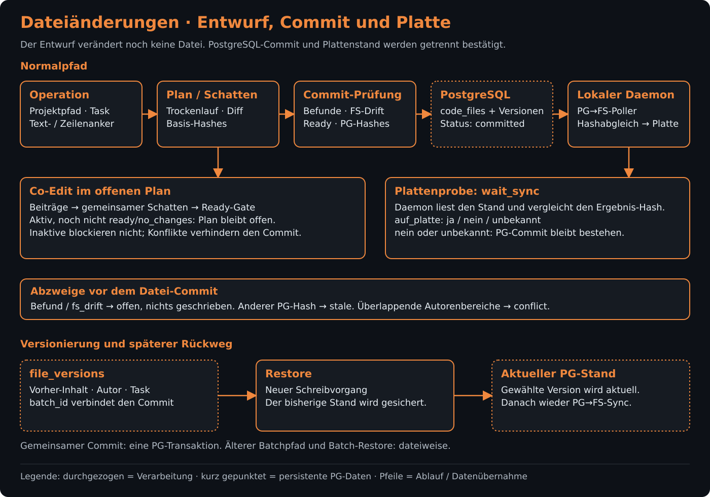
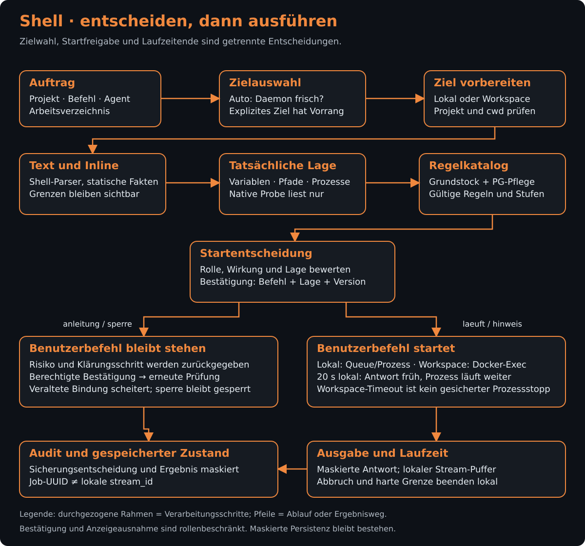
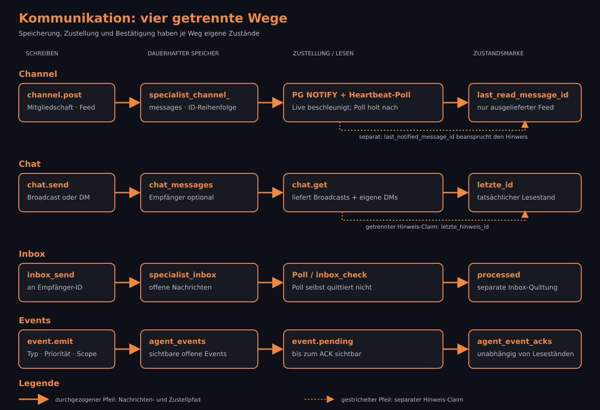
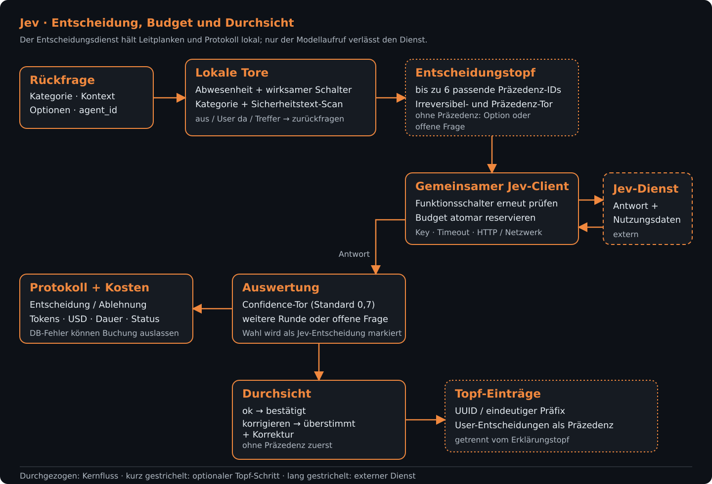

# Services

[Synapse](../../../../README.md) › [Pakete](../../../README.md) › [Core](../../README.md) › [Quellcode](../README.md) › Services

## Zweck

Dieser Ordner enthält die fachlichen Core-Services für Code, Wissen, Dateien, Agenten und Ausführung. Die Dienste werden über die Paket-Exports von REST-API, MCP-Server, Daemon und weiteren Komponenten verwendet.

## Inhalt

Die Inhaltsübersicht ist in drei getrennte Abschnitte aufgeteilt. Jeder Abschnitt nennt die zugehörigen Dateien mit relativen Links und beschreibt deren belegte Aufgabe.

<!-- P19-T4:ANFANG -->
### Teil A (a–i)

#### Dateien und Unterordner

Der T4-Bestand reicht von `agent-id-resolver.ts` bis `intern-warteschlangen.ts`; der separate Syntax-Prüfer liegt unter [syntax-pruefer](syntax-pruefer/README.md).

##### Agenten, Kommunikation und Assets

| Datei | Aufgabe |
|---|---|
| [`agent-id-resolver.ts`](agent-id-resolver.ts) | Löst Agent-IDs für gemeinsame Core-Aufrufe auf. |
| [`agent-meta-yaml.ts`](agent-meta-yaml.ts) | Liest und serialisiert Agenten-Metadaten im YAML-Format. |
| [`agent-onboarding.ts`](agent-onboarding.ts) | Baut den gemeinsamen Onboarding-Datensatz für Agenten auf. |
| [`agent-rollen.ts`](agent-rollen.ts) | Ordnet Agenten Rollen zu und bereitet sichtbare Projektregeln auf. |
| [`agent-wissen.ts`](agent-wissen.ts) | Verwaltet agentenbezogenes Wissen und dessen Zuordnung. |
| [`artefakt.ts`](artefakt.ts) | Validiert und speichert Artefakt-Metadaten und Pfade. |
| [`asset-intel-abfragen.ts`](asset-intel-abfragen.ts) | Führt Asset-Abfragen für Baum, Objekte, Verweise, Suche und Graph aus. |
| [`asset-intel-store.ts`](asset-intel-store.ts) | Speichert Asset-Inspektionen und pflegt Pfade sowie Verweisziele. |
| [`asset-intel-sync.ts`](asset-intel-sync.ts) | Verarbeitet Asset-Dateiänderungen und gleicht den Index mit dem Dateisystem ab. |
| [`asset-intel-tool.ts`](asset-intel-tool.ts) | Definiert und dispatcht das gemeinsame Asset-Intel-Tool. |
| [`asset-weiche.ts`](asset-weiche.ts) | Ergänzt Code-Intel-Ergebnisse um Asset-Daten und Hinweise. |
| [`backup.ts`](backup.ts) | Erstellt und liest JSONL-Sicherungen für Projekt-Collections. |
| [`channels.ts`](channels.ts) | Verwaltet Channels, Mitgliedschaften, Nachrichten und Sichtungsstände. |
| [`channel-unread.ts`](channel-unread.ts) | Erfasst gelesene Channel-Nachrichten und ungelesene Hinweise. |
| [`channelverwalter-regel.ts`](channelverwalter-regel.ts) | Stellt die Regel für Channel-Verwalter bereit. |
| [`chat.ts`](chat.ts) | Registriert Agentensitzungen und verwaltet Broadcasts sowie Direktnachrichten. |
| [`chat-unread.ts`](chat-unread.ts) | Initialisiert den Chat-Lesestand und liefert Hinweise auf neue Nachrichten. |
| [`code-check-tool.ts`](code-check-tool.ts) | Dispatcht Prüfungen bekannter Code- und Fehlermuster. |

##### Code-Intelligence, Dokumentation und Embeddings

| Datei | Aufgabe |
|---|---|
| [`code-intel-schatten.ts`](code-intel-schatten.ts) | Führt optionale Schattenabfragen für Code-Intel aus und misst sie. |
| [`code-intel.ts`](code-intel.ts) | Liefert Projektbaum, Symbole, Referenzen, Volltextsuche und Dateiinhalt. |
| [`code-rename.ts`](code-rename.ts) | Berechnet einen Umbenennungsplan für Code-Symbole. |
| [`code.ts`](code.ts) | Speichert, parst und indexiert Projektdateien und steuert Embedding-Aufträge. |
| [`code-write.ts`](code-write.ts) | Bietet zeilenbasierte Änderungen und PostgreSQL-Dateioperationen. |
| [`context7-automatik.ts`](context7-automatik.ts) | Plant und verarbeitet automatische Context7-Dokumentationsabfragen. |
| [`context7-kontingent.ts`](context7-kontingent.ts) | Reserviert Context7-Aufrufe und verwaltet Kontingentpausen. |
| [`context7.ts`](context7.ts) | Stellt den Context7-Client und die Bewertung von Bibliotheksnamen bereit. |
| [`daemon-bruecke.ts`](daemon-bruecke.ts) | Übermittelt Befehle und Statusmeldungen zwischen Core und lokalem Daemon. |
| [`daemon-heartbeat.ts`](daemon-heartbeat.ts) | Speichert und prüft Daemon-Heartbeats pro Projekt. |
| [`docs-indexer.ts`](docs-indexer.ts) | Indiziert Framework-Dokumentation und hält Suchtreffer im Cache. |
| [`docs.ts`](docs.ts) | Cached und durchsucht Framework-Dokumentation. |
| [`documents.ts`](documents.ts) | Extrahiert Text aus PDF-, Word- und Excel-Dateien und indexiert ihn. |
| [`effort.ts`](effort.ts) | Validiert und wählt eine Aufwandsstufe für Modellaufrufe. |
| [`embed-backlog.ts`](embed-backlog.ts) | Arbeitet ausstehende Embeddings nach und zählt offene Einträge. |
| [`embedding-chunk-id.ts`](embedding-chunk-id.ts) | Erzeugt Inhalts-Hashes und stabile IDs für Embedding-Chunks. |
| [`embedding-claims.ts`](embedding-claims.ts) | Beansprucht Embedding-Chunks und speichert Vektoren samt Claim-Status. |
| [`embed-nachzug.ts`](embed-nachzug.ts) | Schreibt einzelne oder gebündelte Embeddings nach Qdrant zurück. |
| [`embed-prioritaet.ts`](embed-prioritaet.ts) | Bestimmt die Priorität von Embedding-Aufträgen. |
| [`entscheidungstopf.ts`](entscheidungstopf.ts) | Verwaltet Entscheidungsoptionen und deren Auswahlstatus. |

##### Events, Fehlermuster und Dateiverwaltung

| Datei | Aufgabe |
|---|---|
| [`env-maske.ts`](env-maske.ts) | Maskiert .env-Werte in Ausgaben und erhält Platzhalter beim Zurückschreiben. |
| [`erklaerungen.ts`](erklaerungen.ts) | Verarbeitet Erklärungsfälle und bindet Jev-Auswahl sowie Fehlermuster ein. |
| [`error-patterns.ts`](error-patterns.ts) | Verwaltet Fehlermuster und prüft Code gegen bekannte Muster. |
| [`event-sichtbarkeit.ts`](event-sichtbarkeit.ts) | Baut SQL-Bedingungen für Sichtbarkeit und Offenstatus von Events. |
| [`events.ts`](events.ts) | Erstellt Events, quittiert sie und liefert offene Events und Hinweise. |
| [`fehlermuster-auslieferung.ts`](fehlermuster-auslieferung.ts) | Stellt passende Fehlermuster- und Syntaxbefunde bereit. |
| [`fehlermuster-erkennung.ts`](fehlermuster-erkennung.ts) | Validiert und prüft erkannte Muster gegen ihre Erkennungsregeln. |
| [`fehlermuster-pflege.ts`](fehlermuster-pflege.ts) | Normalisiert, findet und pflegt Fehlermuster und Verweise. |
| [`fehlermuster-pruefung.ts`](fehlermuster-pruefung.ts) | Prüft Schreibvorgänge auf Syntaxbefunde und Signaturmuster. |
| [`file-batch.ts`](file-batch.ts) | Plant, prüft und committet Dateiänderungen samt Co-Edit-Status. |
| [`file-diff.ts`](file-diff.ts) | Erzeugt zeilenbezogene Änderungen, Hunks und Diff-Text. |
| [`file-fs-drift.ts`](file-fs-drift.ts) | Erkennt Abweichungen zwischen PostgreSQL-Dateistand und Dateisystem. |
| [`file-reservations.ts`](file-reservations.ts) | Reserviert Datei-Pfade und verwaltet Ablauf, Freigabe und Warteschlangen. |
| [`file-steckbrief.ts`](file-steckbrief.ts) | Erzeugt einen strukturierten Steckbrief zu einer Datei. |
| [`file-task-zuordnung.ts`](file-task-zuordnung.ts) | Ordnet Datei-Versionen Plan-Tasks zu und ergänzt Task-Hinweise. |
| [`file-versions.ts`](file-versions.ts) | Liest Versionshistorien und stellt Versionen oder Batches wieder her. |
| [`free-model-pool-errors.ts`](free-model-pool-errors.ts) | Klassifiziert Anbieterfehler und bewertet weitere Pool-Versuche. |
| [`free-model-pool-store.ts`](free-model-pool-store.ts) | Liest und speichert Anbieter, Modelle, Freigaben, Zugänge und Protokolle. |
| [`free-model-pool.ts`](free-model-pool.ts) | Ermittelt externe Modelle, verwaltet Zugänge und führt Anbieterproben aus. |
| [`global-search.ts`](global-search.ts) | Durchsucht Collections mehrerer Projekte und bündelt Treffer. |

##### Suche, Regeln und interne Werkzeuge

| Datei | Aufgabe |
|---|---|
| [`hinweis-drossel.ts`](hinweis-drossel.ts) | Drosselt wiederholte optionale Projekthinweise. |
| [`ignore-rules.ts`](ignore-rules.ts) | Verwaltet Indexierungsregeln und prüft, ob Pfade ignoriert werden. |
| [`inbox.ts`](inbox.ts) | Sendet und liest Agenten-Inbox-Nachrichten samt Verlauf. |
| [`index.ts`](index.ts) | Bündelt die öffentlichen Re-Exports der Service-Module. |
| [`intern-diagnose-code.ts`](intern-diagnose-code.ts) | Liefert Code- und Parserbefunde für interne Diagnosen. |
| [`intern-diagnose-daemon.ts`](intern-diagnose-daemon.ts) | Führt lokale und per Daemon vermittelte Diagnoseabfragen aus. |
| [`intern-diagnose.ts`](intern-diagnose.ts) | Dispatcht lesende Diagnoseaktionen des internen Tools. |
| [`intern-diagnose-welle2.ts`](intern-diagnose-welle2.ts) | Ergänzt interne Diagnosen um Vektoren, Claims, Events und Pipeline-Spuren. |
| [`intern-einblick.ts`](intern-einblick.ts) | Liefert interne Status- und Datenbankeinblicke. |
| [`intern-modellprofil.ts`](intern-modellprofil.ts) | Liest, ändert und kalibriert Modellprofile. |
| [`intern-nutzung-daemon.ts`](intern-nutzung-daemon.ts) | Liest Skill-Nutzungsdaten über den lokalen Daemon. |
| [`intern-nutzung.ts`](intern-nutzung.ts) | Erstellt Nutzungsstatistiken für Skills. |
| [`intern-ollama.ts`](intern-ollama.ts) | Prüft und steuert lokale Ollama-Modelle und misst Embeddings. |
| [`intern-schalter.ts`](intern-schalter.ts) | Liest und ändert interne Funktionsschalter. |
| [`intern-shell-alt.ts`](intern-shell-alt.ts) | Maskiert und dispatcht Aktionen des älteren Shell-Bestands. |
| [`intern-tool.ts`](intern-tool.ts) | Definiert das optionale interne Diagnose- und Steuerungstool. |
| [`intern-waits.ts`](intern-waits.ts) | Ermittelt und bereinigt veraltete Wait-Zustände. |
| [`intern-warteschlangen.ts`](intern-warteschlangen.ts) | Liefert Diagnosen zu lokalen und daemonbasierten Warteschlangen. |

#### Schnittstellen nach außen

[`index.ts`](index.ts) bündelt die Service-Re-Exports; [`../index.ts`](../index.ts) stellt ausgewählte Services am Core-Einstieg bereit. Die Oberfläche umfasst Agenten-Onboarding und Rollen, Channels und Chat, Code-Intel und Dateiänderungen, Asset-Intel, Embedding-Aufträge, Events sowie interne Diagnose. [`asset-intel-tool.ts`](asset-intel-tool.ts) stellt Definition und Dispatcher des Asset-Intel-Tools gemeinsam für REST und MCP bereit; [`intern-tool.ts`](intern-tool.ts) bündelt das optionale interne Tool.

#### Abhängigkeiten

- PostgreSQL und gemeinsame Datenformen: [`../db/client.ts`](../db/client.ts) und [`../types/index.ts`](../types/index.ts); [`channels.ts`](channels.ts) verwendet den Pool und `ChannelMessage`.
- Code-Index und Dateiänderungen: [`code.ts`](code.ts), [`code-intel.ts`](code-intel.ts), [`code-write.ts`](code-write.ts) und [`file-batch.ts`](file-batch.ts) verbinden Dateiinhalte mit Parsing, Suche und Änderungsplänen.
- Vektorsuche und Embeddings: [`docs.ts`](docs.ts) nutzt [`../qdrant/index.ts`](../qdrant/index.ts) und [`../embeddings/index.ts`](../embeddings/index.ts); [`embedding-claims.ts`](embedding-claims.ts) greift zusätzlich auf Qdrant-Operationen und interne Schalter zu.
- Externe Bibliotheken und Paketgrenzen sind in [`../../package.json`](../../package.json) deklariert. Dazu gehören die hier verwendeten PostgreSQL-, Qdrant-, UUID-, YAML- und Dokumentparser-Bibliotheken.

#### Siehe auch

- [Core-Quellcode](../README.md)
- [Core-Paket](../../README.md)
- [Services: Teil B (j–r)](#teil-b-jr)
- [Services: Teil C (s–z)](#teil-c-sz)
- [Syntax-Prüfer](syntax-pruefer/README.md)
- [Zusammenhang und Betriebsvarianten](../../../../docs/README.md)
<!-- P19-T4:ENDE -->

<!-- P19-T5:ANFANG -->
### Teil B (j–r)

#### Dateien und Unterordner

| Datei / Unterordner | Aufgabe |
|---|---|
| [jev-admin.ts](jev-admin.ts), [jev-client.ts](jev-client.ts), [jev-criteria-katalog.ts](jev-criteria-katalog.ts), [jev-criteria.ts](jev-criteria.ts) | Stellen Admin-Aktionen, den Jev-Aufruf und Kriterien für Empfehlungen bereit. |
| [jev-empfehlung.ts](jev-empfehlung.ts), [jev-entscheidung.ts](jev-entscheidung.ts), [jev-kosten.ts](jev-kosten.ts), [jev-modus-hinweis.ts](jev-modus-hinweis.ts), [jev-optionen.ts](jev-optionen.ts), [jev-schalter.ts](jev-schalter.ts) | Bündeln Planempfehlungen und Rückfrageentscheidungen sowie Kosten, Optionen, Schalter und Modushinweise für Jev. |
| [kontext-korridor.ts](kontext-korridor.ts), [kontextprofil-admin.ts](kontextprofil-admin.ts) | Berechnen Kontextschwellen und stellen administrative Aktionen für Kontextprofile bereit. |
| [mcp-json-maske.ts](mcp-json-maske.ts) | Erkennt und maskiert Geheimniswerte in MCP-JSON, URLs und Diff-Texten und stellt Sicht- und Entmaskierungsfunktionen bereit. |
| [memory.ts](memory.ts) | Verwaltet Memories einschließlich Suche, Embedding-Nachzug, Pfadbezügen und Onboarding-Regeln. |
| [model-cutoffs.ts](model-cutoffs.ts), [model-registry.ts](model-registry.ts), [models-dev.ts](models-dev.ts) | Lösen Modell-Cutoffs und Providerdaten auf; models-dev.ts liest ergänzende Modelldaten aus dem lokalen Dateisystem. |
| [neu-einbetten.ts](neu-einbetten.ts), [parser-health.ts](parser-health.ts) | Ordnen erneutes Einbetten ein und koordinieren es; erfassen Parserabdeckung und Parsergesundheit. |
| [plan-befunde.ts](plan-befunde.ts), [plan-einordnen.ts](plan-einordnen.ts), [plan-hints.ts](plan-hints.ts), [plan-kurz-ids.ts](plan-kurz-ids.ts), [plans.ts](plans.ts), [plan-zuweisung.ts](plan-zuweisung.ts) | Verwalten Planbefunde und -hinweise, Kurz-IDs, Plan- und Taskänderungen sowie Einordnung und Zuweisung von Tasks. |
| [project-init-queue.ts](project-init-queue.ts) | Stellt eine persistente Warteschlange für Projektinitialisierungsaufträge bereit. |
| [project-record-ids.ts](project-record-ids.ts), [project-registry.ts](project-registry.ts), [project-setup-status.ts](project-setup-status.ts), [project-status.ts](project-status.ts) | Lösen Projekt-IDs auf und verwalten Registry, Setup-Phase, Projektstatus und Onboarding-Metadaten. |
| [projekt-db.ts](projekt-db.ts), [projekt-pfad.ts](projekt-pfad.ts) | Prüfen Projekt-DB-Ziele und bilden Projektpfade sowie zulässige Schreibziele ab. |
| [proposal-ids.ts](proposal-ids.ts), [proposals.ts](proposals.ts) | Lösen Vorschlags-IDs auf und stellen Anlegen, Abrufen, Suchen und Statusänderungen für Vorschläge bereit. |
| [rollen-pruefung.ts](rollen-pruefung.ts) | Prüft, ob die Herkunft für eine Koordinator- oder User-Aktion berechtigt ist. |

#### Schnittstellen nach außen

Der Service-Barrel [index.ts](index.ts) bündelt die Core-Services. Die Planfunktionen aus [plans.ts](plans.ts) werden unter anderem vom Agententransport verwendet; [proposals.ts](proposals.ts) wird von den MCP- und REST-MCP-Wegen aufgerufen. Jev- und Kontextprofil-Adminfunktionen sind in den Admin-Tools angebunden. [neu-einbetten.ts](neu-einbetten.ts) wird vom internen Core-Werkzeug verwendet.

#### Abhängigkeiten

Mehrere Dienste speichern oder lesen Daten über den Core-Datenbankzugriff [../db/client.ts](../db/client.ts). Memories, Pläne und Vorschläge greifen außerdem auf Einbettungs- und Qdrant-Funktionen zurück; Projektstatus- und Registry-Dienste verbinden den Datenbankzugriff mit Pfad- und Dateisystemfunktionen. Die Jev-Module teilen sich Client-, Kosten-, Options- und Schalterlogik. Weitere Verbindungen bestehen zu Plan-Kurz-IDs, Wrapperstatus, Rollenprüfung und Einbettungsnachzug. [models-dev.ts](models-dev.ts), [projekt-db.ts](projekt-db.ts) und [projekt-pfad.ts](projekt-pfad.ts) nutzen Node-Dateisystem-, Pfad- oder Kryptografie-Module für ihre jeweiligen lokalen Aufgaben.

#### Siehe auch

- [Core-Quellcode](../README.md)
- [Zusammenhang](../../../../docs/README.md)
<!-- P19-T5:ENDE -->

<!-- P19-T6:ANFANG -->
### Teil C (s–z)

#### Dateien und Unterordner

##### Shell-Ausführung und Queue

| Datei | Aufgabe |
|---|---|
| [`shell-exec.ts`](shell-exec.ts) | Gemeinsamer Shell-Ausführungsdienst für MCP und REST mit Projektauflösung, Aktivitätsprüfung, Arbeitsverzeichnis-Schutz und Stream-Verwaltung. |
| [`shell-queue.ts`](shell-queue.ts) | Persistiert Shell-Jobs in PostgreSQL und verwaltet Einreihung, Übernahme, Ergebnis, Abbruch, Verlauf und Bereinigung. |
| [`shell-hints.ts`](shell-hints.ts) | Stellt Hinweise zu laufenden Shell-Jobs für Tool-Antworten bereit und verfolgt deren Ausgabe. |
| [`shell-channel-unterbrechung.ts`](shell-channel-unterbrechung.ts) | Prüft Channel-Mitgliedschaft und unterbricht das Warten eines Shell-Aufrufs, wenn eine neue Channel-Nachricht eingeht. |
| [`shell-job-anzeige.ts`](shell-job-anzeige.ts) | Formt gespeicherte Shell-Jobdetails und Verlauf für die Tool-Ausgabe. |
| [`shell-job-hinweis.ts`](shell-job-hinweis.ts) | Drosselt optionale Datenbankhinweise im äußeren Antwortpfad eines Shell-Jobs. |
| [`shell-einreihung-sicherung.ts`](shell-einreihung-sicherung.ts) | Prüft Shell-Aufrufe beim Einreihen, bevor ein Job angehängt oder aus dem Cache bedient wird. |

##### Shell-Sicherung, Lage und Ausgabe

| Datei | Aufgabe |
|---|---|
| [`shell-sicherung-parser.ts`](shell-sicherung-parser.ts) | Zerlegt Shell-Text in eine begrenzte lexikalische Struktur, ohne Expansion oder Ausführung. |
| [`shell-inline-pruefung.ts`](shell-inline-pruefung.ts) | Ermittelt Syntax- und Aufruffakten aus Shell-Skripten für die Sicherungsregeln. |
| [`shell-sicherung.ts`](shell-sicherung.ts) | Lädt und befüllt den Sicherungskatalog und prüft normalisierte Shell-Kommandos. |
| [`shell-sicherung-seed.ts`](shell-sicherung-seed.ts) | Enthält die festen Ausgangsregeln des Shell-Sicherungskatalogs. |
| [`shell-sicherungs-lauf.ts`](shell-sicherungs-lauf.ts) | Verbindet Sicherungskatalog, Prozesslage und maskierte Job-Audits im Shell-Startpfad. |
| [`shell-sicherungs-vertrag.ts`](shell-sicherungs-vertrag.ts) | Definiert die gemeinsamen Shell-Sicherungsparameter und Antwortfelder für REST und stdio. |
| [`shell-start-sicherung.ts`](shell-start-sicherung.ts) | Trifft als reine Funktion die Startentscheidung für einen Shell-Aufruf und erzeugt nötigenfalls eine Bestätigung. |
| [`shell-start.ts`](shell-start.ts) | Wählt die native Shell anhand der Auswahl und Plattform. |
| [`shell-teilbar.ts`](shell-teilbar.ts) | Entscheidet anhand einer Positivliste, ob Shell-Aufrufe denselben Lauf teilen dürfen. |
| [`shell-lage.ts`](shell-lage.ts) | Ermittelt Shell-Ausführungskontext und Risiken, ohne den Nutzerbefehl selbst auszuführen. |
| [`shell-lage-probe.ts`](shell-lage-probe.ts) | Stellt eine native, schreibgeschützte Dateisystemprobe für Shell-Lageprüfungen bereit. |
| [`shell-prozess-lage.ts`](shell-prozess-lage.ts) | Ermittelt geschützte Metadaten zur eigenen Prozesskette, ohne Nutzerbefehle oder Signale auszuführen. |
| [`shell-job-umgebung.ts`](shell-job-umgebung.ts) | Baut die an einen Shell-Job übergebene Umgebung und verwaltet den zugehörigen Pfadcache. |
| [`shell-maske.ts`](shell-maske.ts) | Liest Projektwerte und maskiert Shell-Daten vor Speicherung, Antwort und Audit. |
| [`shell-masken-katalog.ts`](shell-masken-katalog.ts) | Bündelt Erkennungsregeln und Treffer für die Shell-Maskierung. |
| [`shell-altbestand.ts`](shell-altbestand.ts) | Gruppiert gefundene Geheimniswerte in historischen Shell- und Tool-Protokollen und bewertet sie, ohne die Protokolle zu ändern. |
| [`shell-altbestand-persistenz.ts`](shell-altbestand-persistenz.ts) | Liest und markiert ausgewählte historische Shell- und Tool-Daten nach einer Bewertung; laufende Shell-Jobs bleiben dabei ausgenommen. |
| [`shell-build-log-fakten.ts`](shell-build-log-fakten.ts) | Leitet begrenzte Fakten aus einfachen Build-Schleifen für die Prüfung der Shell-Lage ab. |
| [`shell-ausgabe-puffer.ts`](shell-ausgabe-puffer.ts) | Puffert Shell-Ausgabe begrenzt und maskiert unvollständige Werte über Zeilengrenzen hinweg. |
| [`shell-ergebnis-hinweis.ts`](shell-ergebnis-hinweis.ts) | Ergänzt Shell-Ergebnisse bei Bedarf um Hinweise aus der Fehlerverarbeitung. |

##### Skills, Spezialisten und Projektbezüge

| Datei | Aufgabe |
|---|---|
| [`skill-hook.ts`](skill-hook.ts) | Ermittelt Skill-Vorschläge anhand von Werkzeugen, Channels und Quellen für Tool-Antworten. |
| [`skills.ts`](skills.ts) | Verwaltet Skill-Suche, Sichtbarkeit, Sections und Schreibvorgänge; PostgreSQL ist die Quelle der Wahrheit. |
| [`specialist-queue.ts`](specialist-queue.ts) | Persistiert Spezialisten-Aufträge und verwaltet Einreihung, Übernahme, Ergebnis und Ablauf. |
| [`specialist-respawn.ts`](specialist-respawn.ts) | Prüft den Kontextkorridor und löst den gemeinsamen Spezialisten-Respawn aus. |
| [`specialist-selbst.ts`](specialist-selbst.ts) | Stellt Spezialisten gespeicherte oder daraus berechnete Angaben zu Modell, Kontext und Wissensstand bereit. |
| [`specialist-spawn-args.ts`](specialist-spawn-args.ts) | Vereinheitlicht Spawn-Eingaben für Einzel- und Batch-Aufträge in das Worker-Argumentformat. |
| [`spezialisten-status-filter.ts`](spezialisten-status-filter.ts) | Filtert Spezialistenstatus nach Namen und kennzeichnet veraltete Wrapper-Einträge. |
| [`task-id-resolver.ts`](task-id-resolver.ts) | Löst Task-Referenzen projektgebunden in PostgreSQL auf. |

##### Technologie- und Wissensdienste

| Datei | Aufgabe |
|---|---|
| [`tech-detection.ts`](tech-detection.ts) | Erkennt Frameworks und Bibliotheken aus Projektmanifesten und Importen. |
| [`tech-docs.ts`](tech-docs.ts) | Speichert, durchsucht und verwaltet kuratierte Technologie-Dokumentation in PostgreSQL und Qdrant. |
| [`thought-ids.ts`](thought-ids.ts) | Löst vollständige Thought-IDs und eindeutige Präfixe auf und liest Thoughts aus PostgreSQL. |
| [`thoughts.ts`](thoughts.ts) | Speichert, durchsucht, aktualisiert und löscht Gedanken und Notizen; nachgelagerte Einbettungen werden angestoßen. |
| [`topf-ansicht.ts`](topf-ansicht.ts) | Liefert eine kompakte Ansicht gespeicherter Einträge des Entscheidungstopfs über UUIDs. |
| [`wissen-stuecke.ts`](wissen-stuecke.ts) | Teilt längere Wissenseinträge in Stücke und unterstützt deren Einbettung sowie Nachzug. |

##### Tool-Antworten, Regeln und Laufzeitsteuerung

| Datei | Aufgabe |
|---|---|
| [`tool-antwort.ts`](tool-antwort.ts) | Baut gemeinsame Tool-Antworten und ergänzt Hinweise oder kompakte Ergebnisdarstellungen. |
| [`tool-call-log.ts`](tool-call-log.ts) | Protokolliert Tool-Aufrufe als Aktivitätsdaten und stellt Filterabfragen bereit. |
| [`unbekannte-parameter.ts`](unbekannte-parameter.ts) | Erkennt unbekannte Werkzeugparameter und erstellt eine Übersicht erlaubter Parameter. |
| [`update-anker.ts`](update-anker.ts) | Prüft Textanker gegen den aktuellen Dateiinhalt, bevor ein gezieltes Update angewendet wird. |
| [`user-herkunft.ts`](user-herkunft.ts) | Überträgt authentifizierte UI-Herkunft innerhalb eines asynchronen Aufrufkontexts. |
| [`werkzeug-regeln.ts`](werkzeug-regeln.ts) | Ermittelt Regeln, die mit einem konkreten Werkzeugaufruf verknüpft sind. |
| [`warteschlangen-register.ts`](warteschlangen-register.ts) | Registriert prozesslokale Warteschlangen, damit interne Werkzeuge deren Zustand abfragen können. |
| [`worker-steuerung.ts`](worker-steuerung.ts) | Verwaltet den prozesslokalen Zustand zum Pausieren, Fortsetzen und gezielten Auslösen von Hintergrund-Workern. |
| [`wrapper-prozess.ts`](wrapper-prozess.ts) | Prüft lokale Wrapper-Prozessidentität und beendet oder bereinigt passende Prozesse. |
| [`wrapper-status.ts`](wrapper-status.ts) | Speichert den PostgreSQL-Status laufender Wrapper und verwaltet Heartbeat-Einstellungen. |

#### Schnittstellen nach außen

[`index.ts`](index.ts) bündelt unter anderem die Exporte für Technologieerkennung und -dokumentation, Thoughts, Shell-Hinweise und Shell-Queue sowie die Spezialisten-Queue. Der Shell-Ausführungsdienst [`shell-exec.ts`](shell-exec.ts) wird gemeinsam vom MCP-Werkzeug und REST-Endpunkt verwendet. Die übrigen Hilfsdienste stellen Funktionen für diese Service- und Werkzeugpfade bereit.

#### Abhängigkeiten

Die Shell-Queue und die Spezialisten-Queue speichern Aufträge in PostgreSQL; der Shell-Startpfad verbindet Parser, Sicherungskatalog, Prozesslage, Umgebung und Maskierung. Technologie-Dokumentation und Skills verwenden PostgreSQL als Quelle persistenter Daten und Qdrant für Suchvektoren. Die Einbettung von Thoughts und Wissensstücken läuft über die jeweiligen nachgelagerten Einbettungspfade. Gemeinsame Tool-Antworten, Regelauflösung und Statusdienste werden von REST-, MCP- und Worker-Pfaden genutzt.

#### Siehe auch

- [Core-Quellcode](../README.md)
- [Zusammenhang](../../../../docs/README.md)
<!-- P19-T6:ENDE -->

## Funktionsweise

### Dateiänderungen, Co-Edit und Platten-Synchronisation

#### Vom Entwurf zum gespeicherten Stand

Eine Dateiänderung beginnt als Operation auf projektbezogenen Pfaden. [planBatch](file-batch.ts) löst den Task-Bezug auf, normalisiert und prüft die Pfade und lädt den aktuellen Inhalt aus PostgreSQL. Die Operationen laufen zunächst auf einem **Schattenstand**: Einfügungen, Ersetzungen, Verschiebungen und Löschungen verändern diesen Entwurf, noch nicht `code_files` oder die Platte. Vorschau, Diff, Text-/Zeilenanker und Basis-Hashes beschreiben, auf welchen Stand sich die Änderung bezieht. Syntax- und Fehlermusterbefunde gehören zu den betroffenen Operationen; ein gespeicherter Plan mit gescheiterten Operationen ist kein erfolgreicher Schreibvorgang.

Beim Commit werden die Befunde gegen den aktuellen Entwurf geprüft. Ein offener sperrender Befund verhindert das Schreiben. Der [Plattenvergleich](file-fs-drift.ts) ermittelt, soweit ein physischer Projekt-Host erreichbar ist, einen eigenen Datei-Hash: bekannte ältere Synapse-Stände können kurz auf den Sync warten; eine nachgewiesene fremde Abweichung ergibt `fs_drift`, der Plan bleibt offen. Ohne prüfbaren Host lautet das Ergebnis `ungeprueft`; das ist kein Nachweis der Gleichheit.

Vor der Übernahme werden Plan und betroffene Dateistände gesperrt und die aktuellen Hashes mit der Planbasis verglichen. Ein anderer PG-Inhalt macht den Plan `stale`. Erst bei anwendbaren, konfliktfreien Operationen werden der neue `code_files`-Stand und die Versionsdaten gespeichert. `committed` bezeichnet die abgeschlossene Übernahme in PostgreSQL.

Die **gemeinsame Co-Edit-Transaktion** speichert Dateien und Vorherstände zusammen; ein Transaktionsfehler rollt diese Schreibvorgänge zurück. Der ältere Batchpfad schreibt dagegen dateiweise über Funktionen mit eigenen Transaktionen. Dort ist ein bereits gespeicherter Dateistand nicht allein durch einen späteren Fehler an einer anderen Datei zurückgerollt. Eine pauschale Atomaritätsgarantie für jeden Multi-File-Aufruf wäre deshalb falsch. Der spätere Platten-Sync gehört zu keiner dieser Schreibtransaktionen.

#### Ein gemeinsamer Entwurf mit mehreren Autoren

[Dateireservierungen](file-reservations.ts) koordinieren überlappende Pfade. Co-Edit führt Beiträge in einen gemeinsamen Zielplan; ein Trägerplan beziehungsweise Wait hält zurückgestellte Beiträge und ihre Zuordnung fest. Der gemeinsame Schatten berücksichtigt die Operationen der beteiligten Autoren, statt unabhängig vorbereitete Komplettdateien übereinanderzuschreiben. Überlappende Änderungen verschiedener Autoren können einen terminalen `conflict` erzeugen; reine Einfügungen am selben Punkt werden gesondert behandelt.

Das Ready-Gate wartet auf gebundene Beitragende, die noch nicht `ready` oder `no_changes` gemeldet haben **und** jüngst Tool-Aktivität hatten. Die Antwort `waiting_for_contributors` beschreibt einen offenen Plan, keinen neuen gespeicherten Plan-Endzustand. Inaktive Beitragende blockieren nicht; ihre bereits eingebrachten Operationen bleiben Bestandteil des Commits. Der Commit-Aufrufer gilt für seinen eigenen Beitrag als fertig.

Ein Rückzug entfernt nur die Operationen des zurückziehenden Autors, solange fremde Beiträge verbleiben. Der Rest wird erneut trocken geprüft; zieht der Owner zurück, kann die Eigentümerschaft auf einen verbleibenden Autor übergehen. Das Rückzugsprotokoll bleibt erhalten. Ein Beitrag nach einem abgeschlossenen Commit landet auf aktueller Basis in einem Folgeplan. Zeilenoperationen werden umgerechnet; ist ihre frühere Stelle inzwischen verändert, wird die Zuordnung mit `late_line_ops_unmappable` abgelehnt, statt eine andere Zeile zu treffen.

| Situation | Bedeutung für den Dateiinhalt |
|---|---|
| Offener Plan / wartende Beitragende | Entwurf vorhanden; noch kein Datei-Commit. |
| Gescheiterte Operation / sperrender Befund / `fs_drift` | Dateischreiben verhindert; der offene Entwurf bleibt prüfbar. |
| `stale` / `conflict` | Planbasis beziehungsweise gemeinsame Operationen sind nicht mehr committbar. |
| `committed` | Neuer Inhalt und Versionsdaten sind in PostgreSQL gespeichert. |
| `cancelled` | Entwurf beendet; ein Rückzug aus einem weiterlaufenden gemeinsamen Plan betrifft nur eigene Beiträge. |

#### Versionierung und Rückweg

[file_versions](file-versions.ts) enthält **Vorherstände**, nicht ausschließlich fertige Ergebnisdateien. Beim Einzel-Update entsteht ein Snapshot, wenn ein vorhandener Inhalt geändert wird. Im gemeinsamen Commit werden Vorherstände je Datei, Autor und Task-Bezug zusammengefasst; `batch_id` verbindet sie mit dem Commit. `task_id` wird aus der projektbezogenen Task-Referenz aufgelöst und ermöglicht die fachliche Zuordnung. Fehlender Task-Bezug in älteren Versionen wird nicht durch eine automatische Migration ergänzt. Der Ergebnis-Hash und das Historienfeld `nachher` beschreiben dagegen den Stand nach der Änderung.

Ein Restore ist ein **neuer Schreibvorgang**: Der gewählte Vorherstand wird aktuell und der bisherige Inhalt wird wiederum versioniert. Ein Batch-Restore führt die Wiederherstellungen dateiweise aus; er ist kein gemeinsamer atomarer Rückwärts-Commit. Bereits erfolgte spätere Änderungen werden durch den wiederhergestellten Stand ersetzt. Ein Transaktions-Rollback vor dem Commit und ein Restore nach dem Commit sind daher unterschiedliche Rückwege.

#### Datenbank-Commit und Platte sind zwei Bestätigungen

Nach dem PG-Commit folgt die lokale Übernahme durch den [PG→FS-Poller](../watcher/index.ts). Er vergleicht Inhalte per Hash, beachtet Pfadschutz und zurückgestellte lokale Ereignisse und überschreibt eine fremde, in den Versionen unbekannte lokale Änderung nicht einfach. Ein passender Hash benötigt keinen erneuten Schreibvorgang. Parsing und Embedding laufen getrennt nach; ein erfolgreicher Datei-Commit garantiert noch keinen aktuellen Vektorindex.

`wait_sync` ergänzt eine zeitlich begrenzte **Leseprobe** beim eindeutig verbundenen lokalen Daemon. Sie fragt den Plattenstand ab und vergleicht ihn mit dem Commit-Hash; bei einer Löschung wird die Abwesenheit geprüft. Sie führt keinen zweiten PG-Commit aus und ersetzt den Poller nicht.

| `auf_platte` | Aussage der Probe |
|---|---|
| `ja` | Ergebnis-Hash stimmt beziehungsweise der gelöschte Pfad fehlt. |
| `nein` | Ein lesbarer Plattenstand entsprach bis zum Ende des Wartebudgets noch nicht dem Ergebnis. |
| `unbekannt` | Kein eindeutiger Daemon oder keine belastbare Antwort; ohne `wait_sync` bleibt die Bestätigung ebenfalls unbekannt. |

Auch `nein` oder `unbekannt` rollen einen bereits erfolgreichen PG-Commit nicht zurück. Die Unterscheidung verhindert, dass eine Datenbankbestätigung mit einer Zusage über lokale Build-Eingaben verwechselt wird.

Quellen: [Plan, Co-Edit und Commit](file-batch.ts), [Einzelschreibweg und Snapshots](code-write.ts), [FS-Drift](file-fs-drift.ts), [Versionsabruf und Restore](file-versions.ts), [PG→FS-Synchronisation](../watcher/index.ts). Die [Syntax-Prüfer](syntax-pruefer/README.md) erklären ihren Anteil am Schreibtor.

### Shell-Ausführung und Workspaces

#### Ziel und Startentscheidung

Das Shell-Werkzeug wählt zuerst den Ausführungsort. Im automatischen REST-Pfad führt ein frischer Daemon-Heartbeat zum lokalen Rechner, andernfalls zum Workspace-Container. Ein ausdrücklich gewähltes Ziel und die Containeroption gehen dieser Auswahl vor. Die Antwort nennt das tatsächliche Ziel mit `executed_via`. Lokal reiht die [REST-MCP-Route](../../../rest-api/src/routes/mcp.ts) den Auftrag in die PostgreSQL-[Shell-Queue](shell-queue.ts) ein; der lokale stdio-MCP-Pfad kann [execShellCommand](shell-exec.ts) unmittelbar aufrufen. Beide verwenden dieselbe Startprüfung. Die [Workspace-Dokumentation](../../../rest-api/src/services/README.md) beschreibt den getrennten Container-Lebenszyklus.

**Der Benutzerbefehl startet erst nach der Entscheidung.** [shell-lage.ts](shell-lage.ts) zerlegt den Text nach Shell-Art und verbindet ihn mit dem tatsächlichen Arbeitsverzeichnis, Variablen, kanonischen Pfaden, Symlinks und Prozessinformationen des Zielrechners. Für erkannte Inline-Skripte liefert die begrenzte statische Analyse zusätzlich Operations- und Zielfakten. Die Lage-Probe liest diese Informationen; sie führt den Benutzerbefehl nicht zur Probe aus. Nicht auflösbare Variablen, dynamische Ausdrücke oder Parsergrenzen bleiben als Unsicherheit sichtbar. Ein vorbereiteter Container und interne Probeprozesse können zu diesem Zeitpunkt bereits existieren.

[shell-sicherungs-lauf.ts](shell-sicherungs-lauf.ts) verbindet den ausgelieferten Regelgrundstock mit dem gepflegten Katalog aus PostgreSQL; gepflegte gleichnamige Einträge bleiben maßgeblich. [pruefeShellStart](shell-start-sicherung.ts) bewertet die Text- und Lagefakten gegen diesen Katalog und den Schutz eigener Prozesse. Erst danach darf `spawn` beziehungsweise der Docker-Exec für den Benutzerbefehl folgen.

| Stufe | Wirkung |
|---|---|
| `laeuft` | Der Befehl darf starten. |
| `hinweis` | Der Befehl darf starten; die Antwort erklärt die erkannte Lage. |
| `anleitung` | Der Befehl bleibt stehen; die Antwort nennt Risiko, Lage und einen sicheren Klärungsschritt. |
| `sperre` | Der Befehl bleibt stehen; diese Stufe ist nicht übergehbar. |

Eine Bestätigung für einen angehaltenen Befehl benötigt eine berechtigte Koordinator-/User-Rolle und einen begründenden Text. Sie bindet sich an den Hash von Projekt und Befehl, den Lage-Hash und die aktuelle Regelversion. Ändert sich einer dieser Werte, ist die Bestätigung veraltet; eine unberechtigte Rolle reicht auch mit passenden Hashes nicht aus. Eine `sperre` bleibt selbst bei berechtigter Bestätigung bestehen. Die Entscheidung enthält Auditdaten; Queue-Jobs werden damit annotiert, direkte Läufe erhalten bei einer Sicherungsantwort oder Bestätigung einen Sicherungs-Job.

#### Ausgabe, Protokoll und Laufzeit

Die [Job-Umgebung](shell-job-umgebung.ts) entfernt Daemon-Zugangsdaten und setzt den Datenbankkontext des Projekts ausdrücklich. Die [Maskierung](shell-maske.ts) verarbeitet bekannte vertrauliche Werte und erkannte Geheimnisformen. Lokal schützt der [Ausgabepuffer](shell-ausgabe-puffer.ts) auch über Chunk-Grenzen hinweg, bevor Text im Stream-Log landet. Shell-Antworten sowie Ergebnis- und Sicherungsdaten vor PostgreSQL-Persistenz werden ebenfalls maskiert. Eine begründete Anzeigeausnahme ist rollenbeschränkt und wird auditiert; sie schaltet die maskierte Persistenz nicht ab. Diese Grenze betrifft die Shell-Ausgabe und ihre Synapse-Protokolle, nicht beliebige Dateien oder Logs, die das gestartete Programm selbst erzeugt.

Die Queue unterscheidet `pending`, `running` und die Endzustände `done`, `failed`, `rejected` oder `timeout`. Eine Job-UUID bezeichnet den Auftrag; die separate `stream_id` bezeichnet dessen lokalen Ausgabelog. Der lokale Aufruf kehrt regulär nach 20 Sekunden mit `running_background` zurück, während der gespeicherte Job weiter `running` ist. Auch eine neue Channel-Nachricht beendet nur das Warten und meldet `unterbrochen_durch`; sie beendet nicht den Prozess. Erst ein ausdrücklicher Abbruch oder die harte Laufzeitgrenze von drei Stunden löst die Prozessbeendigung aus.

Der Workspace-Pfad liefert stdout/stderr synchron zurück und bietet nicht dieselbe fortsetzbare lokale Queue-/Stream-Semantik. Bei einem Workspace-Timeout werden Warten und Stream beendet. Der Orchestrator sendet dabei kein eigenes Kill-Signal an den Exec-Prozess; aus diesem Timeout allein lässt sich deshalb keine sichere Prozessbeendigung ableiten. Zielauswahl, Startprüfung und Laufzeitende sind drei getrennte Entscheidungen.

### Kommunikation und Hinweiszustellung

Synapse hält vier Kommunikationswege getrennt: projektbezogene Gruppen-Boards (Channels), Broadcasts und Direktnachrichten (Chat), adressierte Inbox-Post sowie steuernde Events. Sie teilen sich PostgreSQL als dauerhaften Speicher, haben aber eigene Nachrichten- und Zustandsmarken.

#### Channel: Gruppenbeiträge, Feed und Lesestand

Ein Channel hat Mitglieder. Beim Beitritt wird für einen neuen Mitgliedseintrag der aktuelle höchste Nachrichtenwert als Ausgangsstand gespeichert; ein erneuter Beitritt setzt einen bestehenden Stand nicht zurück. Beiträge landen in `specialist_channel_messages`. Der Feed ist über Nachrichten-IDs begrenzt und blätterbar: standardmäßig kommen die jüngsten 20 Beiträge zurück, chronologisch sortiert; `order: "asc"` und `since_id` führen zum älteren Anfang, `before_id` blättert rückwärts. Archivierte Beiträge bleiben standardmäßig ausgeblendet und werden nur mit `archiv: true` einbezogen. [Channel-Service](channels.ts#L32) · [Feed-Abfrage](channels.ts#L100)

Nach dem Einfügen löst ein PostgreSQL-Trigger `synapse_channel` mit Projekt, Channel, Absender und Nachrichten-ID aus. Der PG-Transport lauscht auf diesen Kanal. Ein Live-Signal beschleunigt die Zustellung; es ist kein Ersatz für den Heartbeat-Poll. Bei einer getrennten Live-Verbindung läuft der Poll weiter. Der HTTP-Wrapper fragt mit `channel_since_id` und `inbox_since_id` ab; bei gekürzten Antworten setzt er mit der letzten gelieferten ID nach. [Trigger](../db/schema-sql/05_funktionen.sql#L47) · [PG-Transport](../../../../packages/agents/src/transport/pg.ts#L330) · [Wrapper-Livekanal](../../../../packages/agents/src/wrapper.ts#L371) · [HTTP-Poll](../../../../packages/agents/src/transport/api.ts#L436)

Ein ausgelieferter Feed und ein Hinweis sind unterschiedliche Zustände. `channel.feed` speichert die IDs der tatsächlich zurückgegebenen Beiträge als monotonen `last_read_message_id`; REST und stdio rufen dafür denselben Core-Service auf. Das getrennte `last_notified_message_id` beansprucht einen Hinweis auf ungelesene fremde Beiträge. Der Hinweis enthält Zähler und die neueste ID, nicht den Nachrichtentext. Scheitert das Speichern des Lesestands, protokolliert der Service den Fehler und liefert `false`; die Feed-Antwort wird davon nicht abgebrochen. [Lesestand und Hinweis-Claim](channel-unread.ts#L36) · [REST-Feed](../../../../packages/rest-api/src/routes/mcp.ts#L3570) · [stdio-Feed](../../../../packages/mcp-server/src/tools/consolidated/channel.ts#L150)

#### Chat und Inbox: zwei Arten direkter Zustellung

`chat.send` legt Broadcasts mit leerem Empfänger und DMs mit Agent-ID in `chat_messages` ab. Ein agentengefiltertes `chat.get` liefert Broadcasts, an den Agenten gerichtete DMs und dessen eigene Nachrichten. Die ausgelieferten fremden Nachrichten schieben den tatsächlichen Chat-Lesestand in `chat_lesestand.letzte_id` vor. Der optionale Ungelesen-Hinweis beansprucht unabhängig davon `letzte_hinweis_id`; erst `chat.get` aktualisiert den Lesestand. Bei einem Fehler im Hinweis-Claim bleibt die eigentliche Toolantwort verfügbar. [Chat-Sitzungen und Nachrichten](chat.ts#L61) · [Ungelesen-Hinweis](chat-unread.ts#L10)

Die Inbox ist eine separate, adressierte Queue in `specialist_inbox`. Der Wrapper liest neue Einträge nach ID; der Poll selbst quittiert sie nicht. `inbox_check` liest offene Einträge und markiert sie atomar als verarbeitet. Der Wrapper quittiert konkret gelieferte IDs über `inbox/ack`; die REST-Antwort meldet angeforderte, aktualisierte und noch offene Einträge. Leere ID-Listen werden abgewiesen, und die REST-Quittierung prüft den Empfänger. [Inbox-Service](inbox.ts#L16) · [Wrapper-ACK](../../../../packages/agents/src/wrapper.ts#L1218) · [REST-ACK](../../../../packages/rest-api/src/routes/wrapper-bridge.ts#L376)

#### Events: Steuerung und Quittung

Events sind kein Channel-Post und keine Inbox-Nachricht. Ein Event speichert Typ, Priorität, Geltungsbereich, Quelle, optionale Nutzlast und `requires_ack` (standardmäßig wahr). `event.pending` zeigt nicht quittierte, für den Agenten sichtbare Events; ACKs liegen separat in `agent_event_acks`. Projektweite Events (`scope: "all"`) werden erst ab Beginn der aktiven Agentenphase sichtbar, direkt adressierte Events (`scope: "agent:<id>"`) bleiben für den Empfänger sichtbar. Ein ACK ändert weder Channel-Lesestand noch Chat-Lesestand. [Event-Schreiben und ACK](events.ts#L70) · [Pending-Abfrage](events.ts#L175) · [Sichtbarkeit](event-sichtbarkeit.ts#L18)

#### Sitzung: frisch gestartet oder fortgesetzt

`sitzung: "neu"` beginnt eine neue aktive Phase; frühere Broadcast-Events gelten für diese Phase nicht mehr, direkt adressierte Events bleiben offen. `sitzung: "fortsetzung"` desselben aktiven Agenten lässt die aktive Phase bestehen, damit unquittierte Events erhalten bleiben. War die vorige Sitzung inaktiv, beginnt auch eine Fortsetzung eine neue aktive Phase. Ohne Sitzungssignal bleibt der bisherige Zustand unverändert. [Sitzungssignal und Zustandswechsel](chat.ts#L140)

Die unterschiedlichen Tabellen und Marken sind absichtlich getrennt: Channel-Hinweis ist nicht Channel-Lesen, Chat-Hinweis ist nicht Chat-Lesen, Inbox-Verarbeitung und Event-ACK sind jeweils eigene Bestätigungen.

### Jev und Entscheidungen

Jev beantwortet eine Rückfrage nur, wenn der Entscheidungs-Schalter für Projekt und Funktion wirksam ist und der Abwesenheits-Schalter aktiv ist. Der Koordinator setzt die Abwesenheit auf Wunsch des Users; ist der User anwesend oder Jev abgeschaltet, wird an User beziehungsweise Koordinator zurückgegeben. Die Schalter gelten global oder für ein Projekt und können alle Jev-Funktionen oder eine einzelne Funktion betreffen. Ein globales „aus“ hat Vorrang vor einem projektspezifischen „an“. Die wirksame Prüfung berücksichtigt auch eine Budgetpause; der kleine Schalter-Cache wird nach Änderungen aktualisiert und sonst regelmäßig neu gelesen. ([`jev-entscheidung.ts`](jev-entscheidung.ts), `entscheideRueckfrage`; [`jev-schalter.ts`](jev-schalter.ts), `jevWirksam`)

Vor einem Modellaufruf prüft der Entscheidungsdienst Eingabeform und Leitplanken. Erlaubt sind die Kategorien Variante, Reihenfolge, Umsetzungsweg und Formulierung. Aktionen wie Löschen, Deploy, Git, Secrets, Außenwirkung, Kosten, Regeln, Live-Datenbank und Schema bleiben beim User. Der Server prüft zusätzlich Frage, Kontext, Hinweise und angebotene Optionen mit einem Text-Scan; die Kategorie allein ist keine Sicherheitsgarantie. Eine Auswahlfrage braucht beschriebene Optionen, die benennen, wann sie passen. Das Confidence-Tor liegt standardmäßig bei 0,7. Unterhalb davon bleibt die Frage offen; bei einer Auswahl kann eine weitere Runde mit neuen Optionen folgen. ([`jev-entscheidung.ts`](jev-entscheidung.ts), `ERLAUBTE_KATEGORIEN`, `VERBOTENE_KATEGORIEN`, `entscheideRueckfrage`)

Ist die Funktion „Entscheidungstopf“ eingeschaltet, sucht der Dienst zuerst passende, aktive User-Entscheidungen (bis zu sechs Kandidaten). Jev prüft dabei auch, ob die Frage eine irreversible oder externe Aktion auslösen könnte; eine fehlende Einschätzung oder ein Wert ab der konfigurierten Schwelle stoppt die autonome Entscheidung. Für eine passende Präzedenz müssen Kandidat und Confidence-Tor (standardmäßig 0,8) zusammenpassen. Dann erhält die eigentliche Auswahl diese frühere Entscheidung als Kontext. Ohne passende Präzedenz entscheidet Jev nur weiter, wenn die Option `entscheidung_ohne_praezedenz` aktiv ist (Standard: an); das Ergebnis wird gekennzeichnet und in der Durchsicht vorgezogen. Ist die Topf-Funktion ausgeschaltet, läuft der ältere Entscheidungsweg weiter. Topf-Einträge werden über UUID oder eindeutigen ID-Präfix angesprochen. ([`jev-entscheidung.ts`](jev-entscheidung.ts), Präzedenz-Schritt; [`entscheidungstopf.ts`](entscheidungstopf.ts), `holeTopfKandidaten`; [`jev-optionen.ts`](jev-optionen.ts))

Jeder eigentliche Jev-Aufruf geht durch den gemeinsamen Client: Er prüft Schlüssel, wirksamen Funktionsschalter und Budget, reserviert bei gesetzter Grenze einen kleinen Betrag atomar und sendet die Anfrage mit Timeout an den konfigurierten Endpunkt. Eine erreichte globale Monatsgrenze pausiert Jev bis zum Abrechnungsmonat oder bis sie zurückgesetzt, angehoben oder entfernt wird. Fehlt die Kostenangabe der Antwort, schätzt der Client aus Eingabe-Tokens und Listenpreis; Ausgabetokens sind nicht Teil dieser Schätzung. HTTP-, Netzwerk- und Timeoutfehler erhalten einen Aufrufeintrag mit null Kosten. Datenbankfehler beim Reservieren oder Buchen werden protokolliert, blockieren den Jev-Aufruf aber nicht; dadurch kann die Budgetgrenze bei einem DB-Ausfall nicht sicher durchgesetzt werden. ([`jev-client.ts`](jev-client.ts), `rufeJev`; [`jev-kosten.ts`](jev-kosten.ts), `reserviereJevBudget`, `bucheJevAufruf`)

Eine Antwort oberhalb des Confidence-Tors wird mit Wahl, Confidence und Protokoll-ID zurückgegeben. Unsichere, abgelehnte oder offene Fragen erscheinen im Entscheidungsprotokoll; Fehler wie fehlender Schlüssel, Budgetpause, Netzwerkfehler oder ungültige Antwort haben eigene Rückgabepfade. Der Koordinator kann eine Entscheidung überstimmen. Die Durchsicht listet autonome Entscheidungen ohne Urteil auf, ohne Präzedenz zuerst; „ok“ bestätigt eine Entscheidung, „korrigieren“ markiert sie als überstimmt und kann die Korrektur als neuen Topf-Eintrag speichern. Das ist der Entscheidungs-Topf: Er speichert frühere User-Entscheidungen als Präzedenz. Der Erklärungstopf behandelt dagegen asynchron erkannte Syntax- und Fehlermuster und deren generische Erklärungen; beide Töpfe haben getrennte Status- und Pflegewege. ([`jev-entscheidung.ts`](jev-entscheidung.ts), `holeEntscheidungsProtokoll`, `durchsichtEntscheidung`; [`erklaerungen.ts`](erklaerungen.ts); [`jev-admin.ts`](jev-admin.ts))

Details und Statusdaten laufen über getrennte Verwaltungsaktionen: `jev_status`, `jev_schalten`, `jev_budget`, `jev_kosten`, `jev_entscheidungstopf` und `jev_erklaerungstopf`.

## Schnittstellen nach außen

Die öffentlichen Paket-Exports werden in [`../index.ts`](../index.ts) und die Service-Exports in [`index.ts`](index.ts) gebündelt. Die abschnittsbezogenen Schnittstellen stehen jeweils bei Teil A, B und C.

## Abhängigkeiten

Die konkreten internen und externen Abhängigkeiten stehen bei den jeweiligen Teilbereichen. Die gemeinsamen Paketabhängigkeiten definiert [`../../package.json`](../../package.json).

## Siehe auch

- [Core-Paket](../../README.md)
- [Core-Quellcode](../README.md)
- [Tests](../../tests/README.md)
- [Zusammenhang und Betriebsvarianten](../../../../docs/README.md)
