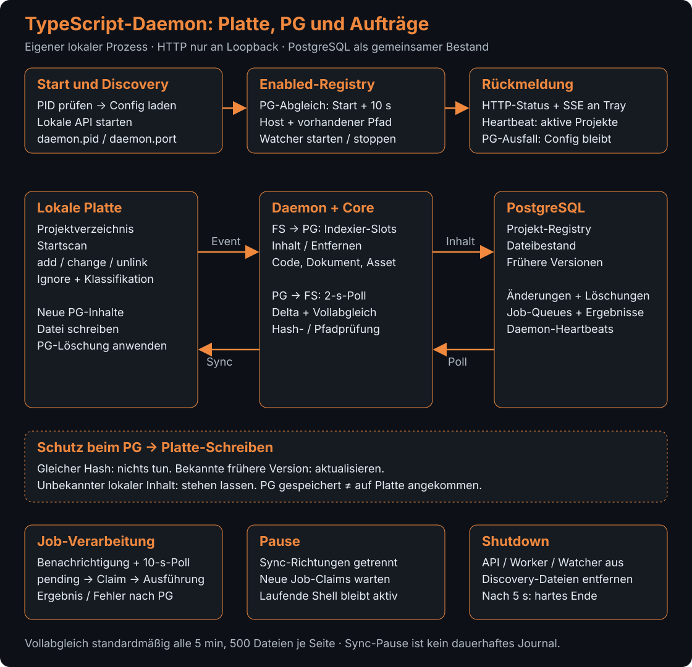

# TypeScript-Daemon-Quellcode

[Synapse](../../../README.md) › [Pakete](../../README.md) › [TypeScript-FileWatcher-Daemon](../README.md) › Quellcode

## Zweck

Der Quellcode startet den Daemon, verwaltet pro Projekt die Dateiüberwachung und bindet HTTP-Routen sowie Hintergrundaufgaben an. Die Komponenten halten die lokale Synchronisation und die von der REST-API eingereihten Jobs zusammen.

## Inhalt

| Datei | Aufgabe |
|---|---|
| [api.ts](api.ts) | Erstellt die Fastify-API des Daemons und bindet deren Routen. |
| [config.ts](config.ts) | Lädt Konfiguration und verwaltet Daemon-Konfigurations- und Discovery-Pfade. |
| [daemon-heartbeat.ts](daemon-heartbeat.ts) | Meldet den Zustand des Daemons über Heartbeat-Daten. |
| [enabled-sync.ts](enabled-sync.ts) | Synchronisiert aktivierte Projekte mit dem laufenden Watcher-Manager. |
| [gpu-helfer-datei.ts](gpu-helfer-datei.ts) | `gpuHelferStatus` liest Einstellungen und Status; `gpuHelferEinstellen` setzt die GPU-Helfer-Einstellungen. |
| [intern-bruecke.ts](intern-bruecke.ts) | Verbindet interne Daemon-Abfragen mit den zuständigen Diensten. |
| [logpflege.ts](logpflege.ts) | Verwaltet die Rotation und Bereinigung lokaler Synapse-Logs. |
| [main.ts](main.ts) | Bootstrapped den Prozess, startet API, Manager und Worker und behandelt den Shutdown. |
| [manager.ts](manager.ts) | Verwaltet Watcher je Projekt und steuert Synchronisations- und Indexier-Slots. |
| [project-init-worker.ts](project-init-worker.ts) | Verarbeitet Projektinitialisierungs-Aufträge. |
| [shell-job-worker.ts](shell-job-worker.ts) | Verarbeitet eingereihte Shell-Jobs für Projekte mit aktivem Watcher. |
| [skills-proxy.ts](skills-proxy.ts) | Stellt die lokale Weiterleitung von Skill-Abfragen bereit. |
| [specialist-job-worker.ts](specialist-job-worker.ts) | Verarbeitet Specialist-Aufträge des Daemons. |

## Funktionsweise

### Start, Steuerdateien und Projektzustände

Der Daemon verbindet das lokale Dateisystem mit PostgreSQL und stellt daneben eine lokale HTTP-API bereit. Tray und zentrale REST-API laufen in getrennten Prozessen. [main.ts](main.ts) prüft zunächst die PID aus `~/.synapse/file-watcher/daemon.pid`: Ist der dort verzeichnete Prozess noch erreichbar, beendet sich der neue Start. Der [Manager](manager.ts) lädt danach `config.json` und startet die darin aktivierten Projekte. Fehlende oder beschädigte Konfiguration fällt auf Standardwerte zurück.

Nach dem erfolgreichen Binden des HTTP-Servers an die Loopback-Adresse schreibt der Daemon `daemon.pid` und `daemon.port` für die Discovery. Die Steuerdateien `start-requested` und `stop-requested` werden hingegen vom separaten [Starthelfer des Trays](../../file-watcher-daemon/tray/start-watcher.sh) ausgewertet, nicht vom Daemon selbst.

[Enabled-Sync](enabled-sync.ts) liest sofort und standardmäßig alle zehn Sekunden die Projekt-Registry für den eigenen Host. Neue lokale Projektpfade werden in die Konfiguration übernommen, sofern sie tatsächlich Verzeichnisse sind; aktive Projekte erhalten einen Watcher. Bei bekannten Projekten gleicht der Dienst das Aktiv-Flag an. PostgreSQL ist dafür maßgeblich, `config.json` bleibt der lokale Rückfall bei einem PG-Ausfall. Ein bereits bekannter Pfad wird durch diesen Discovery-Schritt nicht ersetzt.

`enabled` bezeichnet die gewünschte Aktivierung, `running` eine vorhandene Watcher-Instanz. Die lokale API liefert beide Werte. Aktivieren und Deaktivieren speichern zunächst die Konfiguration, versuchen das PG-Flag zu ändern und starten beziehungsweise stoppen den Watcher. Misslingt die PG-Aktualisierung, wird der Fehler protokolliert; der lokale Wechsel kann trotzdem stattfinden und später durch Enabled-Sync wieder angeglichen werden. Zustandsänderungen des Managers lösen SSE-Meldungen an verbundene Trays aus.

### Zwei Richtungen der Dateisynchronisation

Der [Core-Watcher](../../core/src/watcher/index.ts) führt einen Startscan durch und beobachtet anschließend `add`, `change` und `unlink`. Er berücksichtigt Ignore-Regeln, Sperren und Dateiklassifikation. Der Manager begrenzt die gleichzeitige Indexierung durch Slots und prüft nach dem Warten erneut, ob das Ereignis verarbeitet werden darf. Code und extrahierbare Dokumente gehen über ihre Indexierfunktionen nach PG; Löschereignisse über den Entfernungspfad. Binäre Assets erhalten einen eigenen Verarbeitungsweg. Nach dem Erstscan wird außerdem der Asset-Bestand abgeglichen. Der Textpfad benötigt dafür keinen HTTP-Umweg über die REST-API.

In Gegenrichtung prüft jeder Watcher PG standardmäßig alle zwei Sekunden. Neben Änderungen seit dem letzten Prüfstand verwendet er ein überlappendes Zeitfenster und einen seitenweisen Vollabgleich: standardmäßig zwei Minuten Überlappung, fünf Minuten Abstand zwischen Vollabgleichen und 500 Dateien pro Seite. So können verspätet sichtbare Transaktionen und ältere Rückstände nachgeholt werden, ohne den gesamten Inhalt aller Dateien gleichzeitig zu laden.

Vor dem Schreiben werden Projektgrenze, Sperren, ausstehende lokale Löschereignisse und Inhalts-Hashes geprüft. Identische Dateien bleiben unberührt. Ein abweichender lokaler Inhalt wird nur überschrieben, wenn sein Hash als frühere Dateiversion bekannt ist. Unbekannte lokale Änderungen bleiben stehen. Kann der Watcher einen solchen Pfad wegen seiner Filter oder Klassifikation nicht einsammeln, beseitigt bloßes Warten diesen Unterschied nicht. PG-Löschmarken haben einen eigenen Löschpfad. Ein gespeicherter PG-Stand und sein tatsächlicher Plattenstand sind daher getrennte Ergebnisse.

### Hintergrundjobs und Ausfälle

Der [Heartbeat](daemon-heartbeat.ts) meldet standardmäßig alle zehn Sekunden die aktivierten, laufenden Projekte mit Host und PID nach PG. Die zentrale API verwendet diese Meldungen für die Wahl zwischen lokalem Daemon und Workspace-Ausführung.

Die Worker für [Shell](shell-job-worker.ts), [Spezialisten](specialist-job-worker.ts) und [Projektanlage](project-init-worker.ts) werden durch PG-Benachrichtigungen geweckt; zusätzlich holen Startabgleich und Zehn-Sekunden-Prüfungen wartende Jobs ab. Erst ein erfolgreicher Claim übernimmt einen Auftrag. Shell- und Spezialistenjobs sind an aktive lokale Projekte gebunden, Projektanlage-Jobs an den zuständigen Host. Der Shell-Worker wartet vor dem Claim auf freie Kapazität und speichert nach dem tatsächlichen Prozessende Ergebnis und Ausgabe in PG. Ausführung, Ablehnung, Fehler und Fristablauf bleiben unterscheidbar. Projektanlage löst den Namen gegen den Workspace-Root auf, registriert das Projekt und bindet den Manager ein.

Ein Worker-Startfehler wird protokolliert und beendet nicht zwingend den gesamten Daemon. Ein fehlgeschlagenes HTTP-Binden beendet dagegen den Start. Auch ein laufender Daemon garantiert deshalb nicht, dass jeder Queue- oder Sync-Dienst verfügbar ist; PG-Pollfehler werden beim nächsten Tick erneut versucht.

### Pause und Ende

Die beiden Sync-Richtungen sind getrennt pausierbar. `sync_fs_pg` hält Datei-Ereignisse im Prozess zurück; `sync_pg_fs` überspringt seine Ticks und behält den Prüfstand. Das ist keine persistente Ereigniswarteschlange. Pausierte Job-Worker übernehmen keine neuen Jobs; bereits laufende Shell-Prozesse laufen weiter.

Bei SIGTERM oder SIGINT schließt der Daemon HTTP-Server, Worker, Heartbeat und Watcher, entfernt die Discovery-Dateien und beendet sich. Ein Fünf-Sekunden-Limit erzwingt das Ende, falls das Aufräumen hängt. Dieser Abbruchpfad ist keine Zusage, dass jeder laufende Auftrag vorher erfolgreich abgeschlossen wird.

## Schnittstellen nach außen

[main.ts](main.ts) startet den [Fastify-Endpunkt](api.ts) und den [WatcherManager](manager.ts). Core-Module registrieren Daemon-Worker und stellen Datenbankzugriff sowie Dateisynchronisation bereit. Die API und Worker verbinden den lokalen Prozess mit der REST-API, ohne den Tray in denselben Prozess einzubetten.

## Abhängigkeiten

Die Paketzusammenarbeit verwendet `@synapse/core`, `@synapse/agents` und `@synapse/mcp-server`; Fastify stellt den HTTP-Server bereit. Die Paketgrenzen und Metadaten stehen in [package.json](../package.json).

## Siehe auch

- [TypeScript-Daemon-Paket](../README.md)
- [REST-API-Services](../../rest-api/src/services/README.md)
- [Moo-Daemon](../../file-watcher-daemon/src/README.md)
- [Zusammenhang und Betriebsvarianten](../../../docs/README.md)
