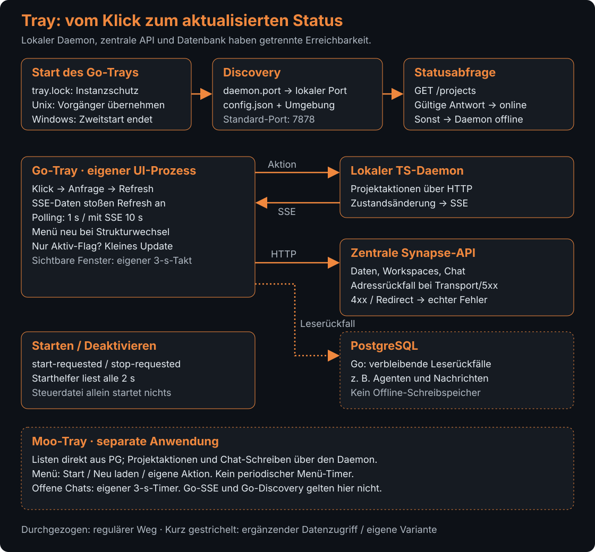

# Synapse-Tray

[Synapse](../../../README.md) › [Pakete](../../README.md) › [Moo-FileWatcher-Daemon](../README.md) › Tray

## Zweck

Der Ordner enthält zwei getrennte Tray-Oberflächen: eine Go-Anwendung mit nativer Tray-Integration und eine Moo-Variante. Sie zeigen Synapse-Status und Projektinformationen und stellen Interaktionen mit API, Datenbank und FileWatcher bereit.

## Inhalt

### Go-Tray

| Datei | Aufgabe |
|---|---|
| [tray.go](tray.go) | Initialisiert die Tray-Anwendung, aktualisiert Menü und Ansichten und verbindet ihre UI-Aktionen. |
| [api_client.go](api_client.go) | Kommuniziert mit der Synapse-API über HTTP und verarbeitet Antworten der API-Clients. |
| [api_client_test.go](api_client_test.go) | Prüft Funktionen des Go-API-Clients. |
| [gpu_setup.go](gpu_setup.go) | Verwaltet GPU-Erkennung und -Konfiguration für die Go-Oberfläche. |
| [gpu_helfer_einstellungen.go](gpu_helfer_einstellungen.go) | Hält Einstellungen des GPU-Helfers. |
| [gpu_setup_test.go](gpu_setup_test.go) | Enthält Tests für GPU-Setup-Funktionen. |
| [gpu_helfer_basen_test.go](gpu_helfer_basen_test.go) | Enthält Basistests für GPU-Helfer. |
| [disk_free_unix.go](disk_free_unix.go) | Stellt freien Speicherplatz für Unix-Systeme bereit. |
| [disk_free_windows.go](disk_free_windows.go) | Stellt freien Speicherplatz für Windows bereit. |
| [lock_unix.go](lock_unix.go) | Implementiert plattformspezifische Sperren für Unix. |
| [lock_windows.go](lock_windows.go) | Implementiert plattformspezifische Sperren für Windows. |
| [proc_unix.go](proc_unix.go) | Implementiert Prozessabfragen für Unix. |
| [proc_windows.go](proc_windows.go) | Implementiert Prozessabfragen für Windows. |
| [start-watcher.sh](start-watcher.sh) | Enthält die Startanbindung des Watcher-Prozesses. |
| [go.mod](go.mod) | Definiert Go-Modul und direkte Abhängigkeiten des Tray-Programms. |
| [go.sum](go.sum) | Fixiert Prüfsummen der Go-Abhängigkeiten. |
| [icon.png](icon.png) | Bildressource des Tray-Symbols. |

### Moo-Tray und Datenbankzugriff

| Datei | Aufgabe |
|---|---|
| [tray.moo](tray.moo) | Implementiert die Moo-Tray-Oberfläche, Projektaktionen und Chat-/Statusansichten. |
| [pg_client.moo](pg_client.moo) | Implementiert den PostgreSQL-Wire-Protocol-Client für direkte Datenbankabfragen aus der Moo-Oberfläche. |
| [pg_test.moo](pg_test.moo) | Enthält Testcode für die Moo-PostgreSQL-Anbindung. |
| [user_chat_test.go](user_chat_test.go) | Enthält Tests zu Chatfunktionen der Go-Oberfläche. |

## Funktionsweise

### Go: vom Start zum sichtbaren Status

Der Go-Tray ist ein eigener Desktop-Prozess. Er liest den Daemon-Port aus `~/.synapse/file-watcher/daemon.port`; fehlt eine brauchbare Angabe, gilt Port 7878. API-Einstellungen kommen aus Umgebung und `config.json`. Die Sperrdatei `tray.lock` begrenzt parallele Instanzen: Unter Unix versucht ein neuer Start, den erkannten Vorgänger zu beenden und dessen Sperre zu übernehmen; unter Windows beendet sich die zweite Instanz. Kann die Sperrdatei gar nicht geöffnet werden, startet der Tray allerdings ohne Sperre. Die Einzelinstanz ist daher keine bedingungslose Garantie.

Das Symbol zeigt die Erreichbarkeit des **lokalen Daemons**. Maßgeblich ist eine erfolgreich dekodierte Antwort auf `GET /projects`, mit drei Sekunden HTTP-Frist. Die zentrale Synapse-API wird getrennt abgefragt. Deshalb bedeutet „Daemon online“ weder „API erreichbar“ noch „alle Daten aktuell“; ein aktiviertes Projekt und ein tatsächlich laufender Watcher sind ebenfalls unterschiedliche Zustände.

Der Daemon liefert über `/events` einen ersten Status und weitere Zustandsänderungen als Server-Sent Events (SSE). Jede `data:`-Zeile stößt eine erneute Abfrage an; der Tray übernimmt den Ereignisinhalt nicht direkt ins Menü. Eine gepufferte Refresh-Anforderung bündelt gleichzeitige Auslöser, ein Mutex serialisiert die Aktualisierung. Zusätzlich läuft Polling: ungefähr jede Sekunde ohne SSE, alle zehn Sekunden bei aktiver SSE-Verbindung. Nach einem Verbindungsabbruch wird SSE erneut aufgebaut.

Ein Wechsel zwischen online und offline oder eine geänderte Projekt-, Workspace- oder Channel-Signatur baut das Menü neu. Ändert sich nur ein Aktiv-Schalter, werden dessen vorhandene Menüeinträge angepasst. Workspaces werden höchstens alle 30 Sekunden abgefragt, nach Fehlern erst nach fünf Minuten; die Channel-Signatur höchstens alle fünf Sekunden. Sichtbare Detail- und Chatfenster haben einen eigenen Drei-Sekunden-Takt. Versteckte Fenster bleiben wiederverwendbar, werden dabei aber nicht abgefragt.

### Go: Klick, Ausführung und Rückmeldung

Ein Projekt-Schalter liest zunächst den aktuellen Status, sendet dann `enable` oder `disable` an den lokalen Daemon und stößt eine Auffrischung an. Nur eine HTTP-200-Antwort führt zur unmittelbaren Anpassung des Schalters. Im Daemon ändert der Manager Konfiguration, Watcher und das Aktiv-Flag in PostgreSQL; anschließend meldet er die Zustandsänderung per SSE.

„Daemon starten“ und „Deaktivieren“ schreiben dagegen `start-requested` beziehungsweise `stop-requested`. Der getrennte [Starthelfer](start-watcher.sh) prüft diese Dateien alle zwei Sekunden und startet oder beendet den TypeScript-Daemon. Der Tray bleibt beim Deaktivieren offen. „Beenden“ fordert zusätzlich sein eigenes Ende an. Ohne laufenden Starthelfer bewirkt die Steuerdatei allein keinen Prozessstart.

Für zentrale Daten verwendet der [API-Client](api_client.go) mehrere Basisadressen derselben Instanz und merkt sich die zuletzt erfolgreiche. Transportfehler und Serverfehler erlauben einen weiteren Versuch; auch unlesbare beziehungsweise ungültige Antworten können zur nächsten Basis führen. HTTP-4xx-Ablehnungen und Redirects werden unmittelbar als Fehler zurückgegeben. Ein Service-Token wird als Bearer-Header übertragen. Das ist ein Adressrückfall, kein lokaler Offline-Schreibspeicher.

Die Implementierung enthält weiterhin direkte **PG-Leserückfälle**, etwa für Agentenlisten und Channel-Nachrichten, wenn der API-Aufruf scheitert. Eine gefüllte Ansicht beweist somit nicht den Erfolg ihres API-Pfads. Beim Senden einer Chatnachricht zeigt der Tray einen Fehler an; erst nach erfolgreichem Senden leert er das Eingabefeld und lädt Nachrichten nach.

### Moo: eigenständige Oberfläche

Die [Moo-Variante](tray.moo) besitzt eine separat konfigurierte Daemon-Adresse und einen direkten [PostgreSQL-Client](pg_client.moo). Listen werden aus PG gelesen; Projektaktionen und Chat-Schreiben laufen über HTTP zum Daemon. Bei verlorener PG-Verbindung wird der Client verworfen und beim nächsten Leseversuch neu verbunden.

Das Menü wird beim Start, durch „Neu laden“ und durch Benutzeraktionen aufgebaut. Obwohl eine Funktion `update_tick` vorhanden ist, wird **kein periodischer Menü-Timer** registriert: Das vermeidet wiederholte Menüaufbauten durch Desktop-Signale. Offene Chats besitzen dagegen einen eigenen Drei-Sekunden-Timer. Die Go-SSE-, Discovery- und Sperrmechanismen dürfen deshalb nicht pauschal auf Moo übertragen werden.

## Schnittstellen nach außen

Der Go-Tray spricht über [api_client.go](api_client.go) mit den HTTP-Endpunkten der Synapse-API und bezieht Status- und Agenteninformationen von dort. Die Moo-Oberfläche verwendet [pg_client.moo](pg_client.moo) für PostgreSQL-Abfragen und [tray.moo](tray.moo) für DateiWatcher- und Projektaktionen. Beide Ansätze bleiben getrennte Anwendungen und teilen sich einzelne Funktionsbereiche.

## Abhängigkeiten

Der Go-Tray basiert auf den in [go.mod](go.mod) festgelegten Bibliotheken; plattformspezifische Dateien kapseln Speicherplatz-, Prozess- und Sperroperationen. Die Moo-Variante benötigt die Moo-Laufzeit. Beide Oberflächen gehören zum [Moo-FileWatcher-Paket](../README.md), der aktuelle TypeScript-Daemon liegt separat in [file-watcher-daemon-ts](../../file-watcher-daemon-ts/README.md).

## Siehe auch

- [Moo-FileWatcher-Daemon](../README.md)
- [Moo-Daemon-Quellcode](../src/README.md)
- [TypeScript-Daemon](../../file-watcher-daemon-ts/README.md)
- [Zusammenhang und Betriebsvarianten](../../../docs/README.md)
