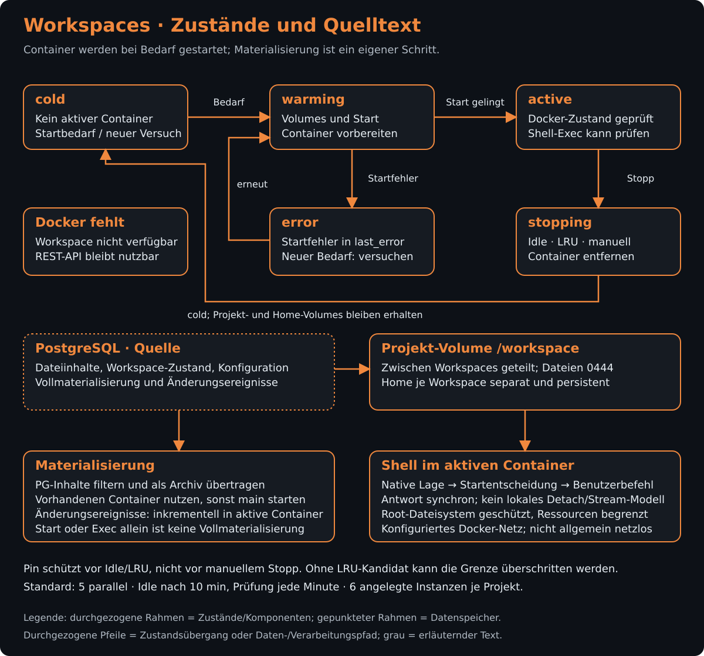

# REST-API-Dienste

[Synapse](../../../../README.md) › [REST-API](../../README.md) › [Quellcode](../README.md) › Dienste

## Zweck

Die Dienste kapseln API-nahe Fachlogik, die von mehreren Routen oder dem Serverstart verwendet wird. Sie verbinden Core-Funktionen mit Authentifizierung, Parser- und Embedding-Arbeit, Containerprüfungen, Workspace-Verwaltung und Ereignisströmen.

## Inhalt

| Datei / Unterordner | Aufgabe |
|---|---|
| [`auth.ts`](auth.ts) | Stellt TOTP-, PKCE- und Tokenfunktionen bereit; speichert Token-Hashes in PostgreSQL. |
| [`embedding-nodes.ts`](embedding-nodes.ts) | Verwaltet Registrierung, Status und Arbeit externer Embedding-Knoten. |
| [`parser-worker.ts`](parser-worker.ts) | Verarbeitet serverseitig den Parse-Backlog und stößt daran angebundene Embedding- und Wissensarbeit an. |
| [`pruef-container.ts`](pruef-container.ts) | Verwaltet den isolierten Prüfcontainer für Syntaxprüfungen außerhalb des Node-Prozesses. |
| [`pruef-container-treesitter.ts`](pruef-container-treesitter.ts) | Enthält die Treesitter-Anbindung des Prüfcontainer-Bereichs. |
| [`workspace-orchestrator.ts`](workspace-orchestrator.ts) | Steuert Workspace-Container und deren Lebenszyklus. |
| [`wrapper-stream.ts`](wrapper-stream.ts) | Verteilt PostgreSQL-Benachrichtigungen als Ereignisse an verbundene Wrapper-Streams und stellt deren Zustand dar. |
| [`agent-runtime`](agent-runtime/README.md) | Runtime-Treiber, Sitzungsverwaltung, Terminale und Artefaktzustellung für Hauptagenten. |

## Funktionsweise: Workspaces

Der [Workspace-Orchestrator](workspace-orchestrator.ts) verwaltet Container pro Projekt und benanntem Workspace. Er startet sie erst bei Bedarf. Ein bloßes Aktualisieren des Aktivitätszeitpunkts startet keinen Container. Mehrere Workspaces desselben Projekts teilen das Quelltext-Volume unter `/workspace`; jeder Workspace besitzt ein eigenes persistentes Home-Volume. PostgreSQL hält Zustand, Konfiguration und Aktivitätszeitpunkt.

### Zustände und Kapazität

| Zustand | Bedeutung und Übergang |
|---|---|
| `cold` | Kein aktiver Container; ein Startbedarf führt zu `warming`. |
| `warming` | Volumes und Container werden vorbereitet. Erfolgreicher Start führt zu `active`, ein Startfehler zu `error`. |
| `active` | Der Container ist nutzbar. Bei erneuter Nutzung wird sein tatsächlicher Docker-Zustand geprüft; ein verschwundener Container wird als `cold` zurückgesetzt und neu gestartet. |
| `stopping` | Der Container wird gestoppt und entfernt. Danach steht der Workspace wieder auf `cold`; die Volumes bleiben erhalten. |
| `error` | Der Start scheiterte; `last_error` beschreibt den Fehler. Ein weiterer Startversuch kann erneut nach `warming` führen. |

Die Standardkonfiguration begrenzt parallele Container auf fünf und prüft minütlich auf zehn Minuten Inaktivität. Beim Start an der Parallelgrenze verdrängt LRU den ältesten aktiven, ungepinnten Workspace. Sind alle Kandidaten gepinnt, lässt die Implementierung eine vorübergehende Überschreitung zu. Ein Pin schützt vor LRU und automatischem Idle-Stopp; ein ausdrücklicher Stopp bleibt möglich. Daneben gilt ein separat konfigurierbares Limit von standardmäßig sechs angelegten Workspace-Instanzen pro Projekt. Dieses zählt auch gespeicherte inaktive Instanzen.

Rollen sind Vorlagen, deren Konfiguration bei der ersten Anlage in die Workspace-Instanz kopiert wird; spätere Änderungen erfolgen an der Instanz. Projektvorlagen haben Vorrang vor globalen Vorlagen. Der optionale Rollen-Initialisierungsbefehl läuft nach jedem Containerstart. Scheitert nur dieser Schritt, bleibt der bereits aktive Container nutzbar und der Fehler wird vermerkt. Änderungen an Image oder Ressourcen benötigen beim aktiven Container einen Neustart.

### Materialisierung und Shell sind getrennt

`materialize` liest den Quelltext aus PostgreSQL, filtert ausgeschlossene Pfade und überträgt ihn als root-eigene Dateien mit Modus `0444` in das gemeinsame Projekt-Volume. Dieser Schritt nutzt einen laufenden Workspace des Projekts oder startet dafür `main`. Ergänzend hört der Orchestrator auf Dateiänderungen in PostgreSQL und überträgt beziehungsweise entfernt einzelne Dateien in bereits aktiven Projekt-Containern. Die Quelle bleibt PostgreSQL; Quelltextänderungen gehören in den versionierten [Dateipfad](../../../core/src/services/README.md).

Der Shell-Exec startet beziehungsweise übernimmt einen Container, ermittelt dort die tatsächliche Lage und trifft die gemeinsame [Shell-Startentscheidung](../../../core/src/services/README.md). Er ruft selbst keine vollständige Materialisierung auf. Ein laufender Container allein garantiert daher nicht, dass zuvor der gesamte aktuelle Quelltext übertragen wurde. Nach Freigabe läuft der Benutzerbefehl als Containerbenutzer mit stdout/stderr-Rückgabe; Home und temporäre Arbeitsbereiche erlauben Laufzeitdaten, während materialisierter Quelltext vor gewöhnlichen Shell-Schreibzugriffen geschützt ist.

Der Container verwendet Ressourcenlimits, ein schreibgeschütztes Root-Dateisystem und einen eigenen temporären Bereich. Er ist an das konfigurierte Docker-Netz angebunden: Workspace-Isolation bedeutet keine allgemeine Netzabschaltung. Privilegierte Rollenoptionen werden zusätzlich gegen die Deployment-Allowlist geprüft. Der [Syntaxprüfcontainer](pruef-container.ts) ist ein anderer Dienst mit anderen Grenzen.

### Fehler und Umfang der Umsetzung

Fehlt der Docker-Socket oder antwortet Docker beim Start nicht, wird der Orchestrator als nicht verfügbar markiert; die REST-API kann weiterlaufen. Workspace-Anforderungen scheitern dann sichtbar mit `workspace_unavailable` beziehungsweise einem Orchestratorfehler. Die automatische Shell-Zielwahl fällt nur dann auf den lokalen Weg, wenn der Daemon zuvor als verfügbar erkannt wurde.

Umgesetzt sind benannte Container, Rollen-Vorlagen, persistente Volumes, Materialisierung, Idle/LRU, Pinning und Ressourcen-Konfiguration. Daraus folgt kein vollständiges Abbild des lokalen Rechners und keine Garantie für beliebige Betriebssystem-, Geräte- oder Dienste-Konfigurationen. Die ausführlichere [Workspace-/Scope-Konzeption](../../../../docs/konzepte/ARCHITEKTUR_WORKSPACE_TESTSYSTEME_SCOPES.md) ordnet weitergehende Ideen ein; maßgeblich für die hier beschriebenen Abläufe bleibt der Orchestratorcode.

## Funktionsweise: Parser- und Embedding-Worker

Der REST-Server startet den [ParserWorker](parser-worker.ts) nach der Initialisierung. In seinem regelmäßigen Tick fragt er Core nach Projekten mit Parse-Backlog; die Auswahl berücksichtigt Registry- und Aktivierungsstatus. Der Worker verarbeitet höchstens 20 Projekte pro Tick. Für jede Datei ruft er denselben Core-Pfad wie andere Parser-Aufrufer auf. Eine transaktionale Sperre pro Datei serialisiert parallele Läufe, etwa mit dem lokalen FileWatcher. Der Parser aktualisiert Symbole, Referenzen, Statements, Aufrufkanten und Code-Chunks in PostgreSQL.

Das Einbetten der Code-Chunks läuft als eigener Hintergrundpfad. Der Server beansprucht Chunks unter seiner Knotenkennung mit befristeter Lease und bettet sie stapelweise mit Hintergrundpriorität ein. Sind externe Embedding-Knoten aktiv, arbeitet der Server mit begrenzter Parallelität mit; ohne sie darf er mehr Slots nutzen. Die Konfiguration kann die Server-Beiträge auch abschalten. Beim Abschluss übergibt er Claim-Bezeichner, Inhaltshash und Vektor an Core, das veraltete oder nicht mehr gültige Claims ablehnt. Fehlerhafte Stapel und abgelehnte Claims werden freigegeben, damit sie nicht bis zum Lease-Ablauf blockieren.

Ein [Compute-Node](../../../compute-node-agent/README.md) ist ein separater Worker-Prozess: Er bezieht Modellprofil und Claims über die REST-API, berechnet Vektoren lokal und meldet sie mit Claim- und Inhaltsdaten zurück. Der Server-Worker kann unabhängig davon weiterarbeiten. Bei beiden Wegen bleiben Claim-Prüfung, Vektorpersistierung und Indexpflege in Core; Details zu Zuständen und Übergängen zeigt das [Embedding-Diagramm](../../../../docs/bilder/embedding.svg).

Der ParserWorker behandelt außerdem den Wissens-Embedding-Backlog als gedrosselten Nachzug, getrennt vom Code-Chunk-Claim-Pfad. Er stößt ebenso die Context7-Automatik an. Medien laufen davon getrennt: Der explizite Medien-Indexierungspfad verwendet einen multimodalen Provider und eine eigene Medien-Collection; er wird nicht durch das Datei-Parsing automatisch eingebettet.

## Schnittstellen nach außen

Die Route-Module verwenden die Dienste direkt, etwa Auth in [`middleware/auth-hook.ts`](../middleware/auth-hook.ts), Embedding-Knoten in den Knotenrouten und Runtime-Funktionen in [`agent-runtimes.ts`](../routes/agent-runtimes.ts). Der Server startet Parser-, Syntaxprüfungs- und Workspace-Dienste während seiner Initialisierung. Die Dienste greifen für Daten und Kernlogik auf [`@synapse/core`](../../../core/README.md) zu.

## Abhängigkeiten

Die Dienste nutzen Core für PostgreSQL-Pool, Parser, Syntaxprüfer, Embeddings und Worker-Status. Fastify-Routen bilden die HTTP-Grenze. Docker-Zugriffe laufen über `dockerode`; der Prüfcontainer kommuniziert ohne Netz über Ein-/Ausgabe des Containers.

## Siehe auch

- [REST-API-Quellcode](../README.md)
- [Routen](../routes/README.md)
- [Agent-Runtime-Dienste](agent-runtime/README.md)
- [Core-Paket](../../../core/README.md)
